# @capgo/capacitor-native-navigation

<a href="https://capgo.app/?ref=plugin_native_navigation">
  
</a>

<div align="center">
  <p>
    <b>Capgo</b>: push fixes to your Capacitor users in minutes, build signed iOS and Android apps without a Mac, and
    roll back in one click.
  </p>
  <h2>
    <a href="https://capgo.app/register/?ref=plugin_native_navigation">➡️ Get started for free</a>
  </h2>
  <p>14-day unlimited free trial. No credit card required</p>
</div>

> 🤖 **Building with an AI coding agent?** Install [Capgo skills](https://capgo.app/skills/?ref=plugin_native_navigation) so Claude Code, Codex, Cursor, Copilot, or Gemini CLI know how to install and use `@capgo/capacitor-native-navigation` in your Capacitor app: `npx skills add Cap-go/capgo-skills`. Then ask your agent: _"Add @capgo/capacitor-native-navigation to my Capacitor app and wire it up."_ [Agent setup guides](https://capgo.app/agents/?ref=plugin_native_navigation) · [Hosted MCP](https://capgo.app/docs/ai/mcp/?ref=plugin_native_navigation)

Native navbar, tab bar, safe-area handling, and WebView snapshot transitions for Capacitor apps. Your web framework keeps routing and page rendering while this plugin owns the platform surfaces: a search field under the large title, a tab bar aligned to the start, center, or end, and a trailing sidebar rail.

**iOS 27 and iPhone Duo.** On iPhone Duo, iOS moves the status bar and the system tab bar into one vertical rail on the folded outer display and on the open display in landscape. Open portrait keeps the horizontal bars. Navbar icon buttons join that rail, and the title stays horizontal. A back or close icon sits at the top. Search can be a detached button, prominent actions stay pinned, and buttons that share a `group` collapse into one control that expands. The curved center bar stays on the bottom. `configure({ verticalBarBehavior: 'disabled' })` keeps the horizontal bars for a screen that should not use the rail.

## Demo

| App                                                                                            | Tap flow                                                                                                                                                | SVG icons                                                                                                                                                 | Styling                                                                                                                                                                                                        |
| ---------------------------------------------------------------------------------------------- | ------------------------------------------------------------------------------------------------------------------------------------------------------- | --------------------------------------------------------------------------------------------------------------------------------------------------------- | -------------------------------------------------------------------------------------------------------------------------------------------------------------------------------------------------------------- |
| 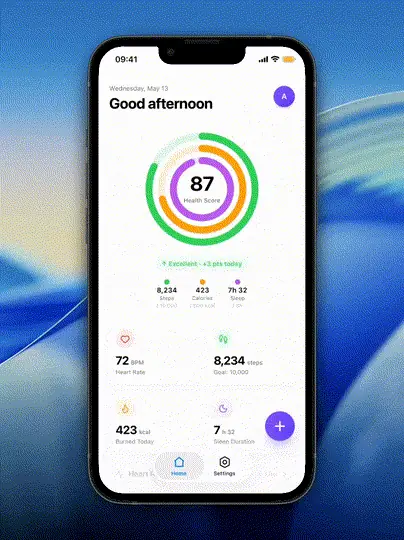 | 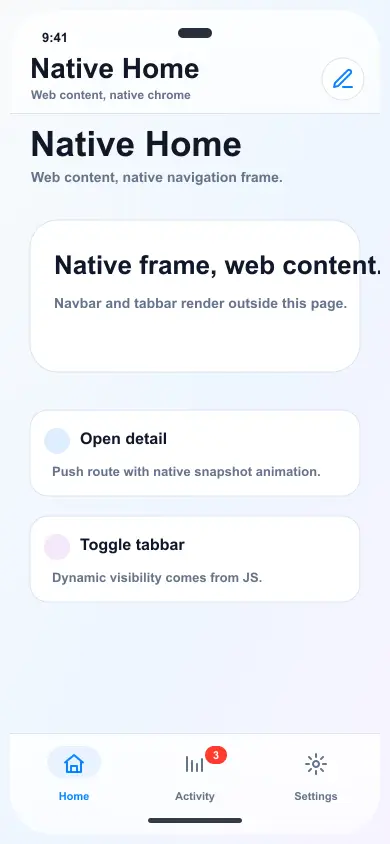 | 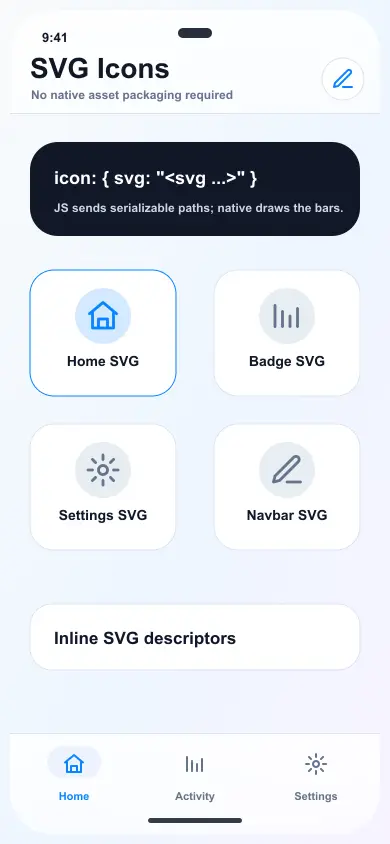 | 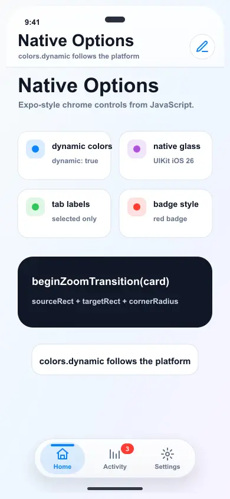 |

| iOS Liquid Glass                                                                                                         | Android blur                                                                                                                                                                      | Android tap flow                                                                                                                                                                                                       | Curved tabbar                                                                                                                                                     |
| ------------------------------------------------------------------------------------------------------------------------ | --------------------------------------------------------------------------------------------------------------------------------------------------------------------------------- | ---------------------------------------------------------------------------------------------------------------------------------------------------------------------------------------------------------------------- | ----------------------------------------------------------------------------------------------------------------------------------------------------------------- |
| 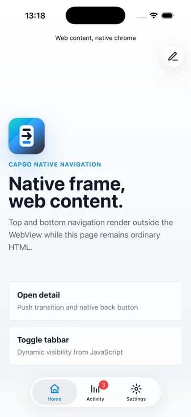 | 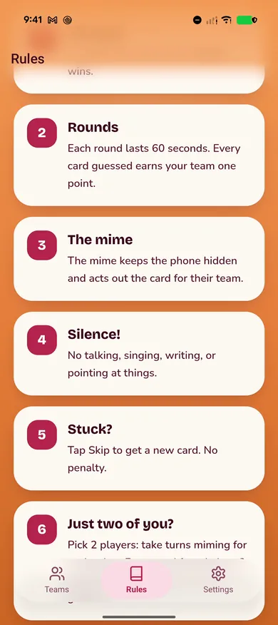 | 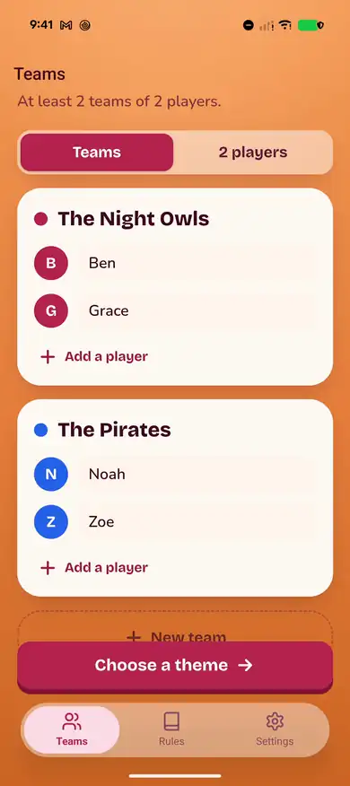 | 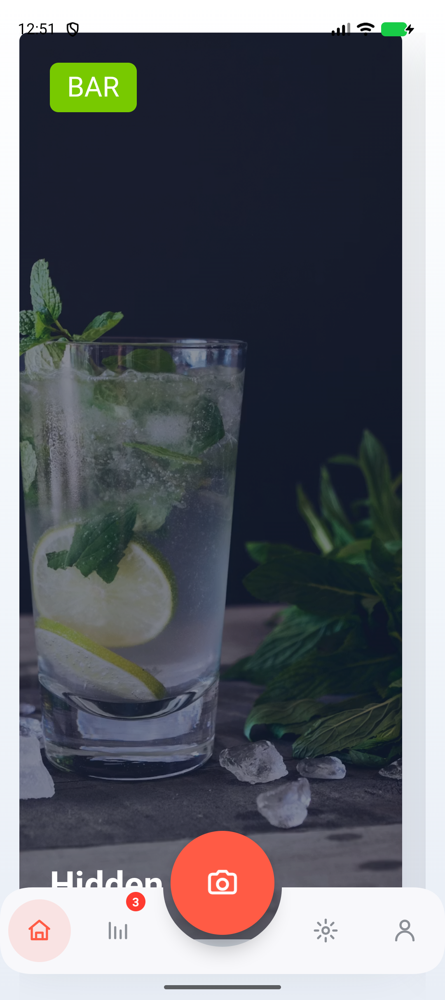 |

The Android captures come from [Mimesis](https://github.com/Cap-go/mimesis) on Android 16: a large navbar title that collapses on scroll, a translucent native tabbar and a transparent navbar over CSS `backdrop-filter` blur.

### iPhone Duo

Folded, and open in landscape, the system tab bar becomes a vertical rail. Open portrait stays a horizontal bar. Split View puts each window's rail on the outer edge. The rail stays on the camera's physical edge, so the semantic edge is trailing in landscape and can be leading or trailing in Split View and in right-to-left layout. The curved center bar stays on the bottom, and its cradle stays a circle around the button when the window widens.

Icon buttons from the navbar join that rail. A text title stays horizontal, so a back control needs `display: 'icon'` (or `role: 'close'`) before it sits at the top of the rail. `dock: 'detached'` draws a button on its own. `dock: 'prominent'` pins it past overflow and search. `axis: 'vertical'` puts a text button such as Done on the rail. Items that share `group` collapse to the first item, and the system expands the rest. `search.placement: 'button'` is a detached search button on the iPhone Duo rail in iOS 26 and later. A horizontal navbar, Android, and web keep the stacked field. `verticalBarCompression: 'preferItems'` keeps navbar buttons when the rail runs out of room. Segment rows stay horizontal and clear the rail. Curve and other custom capsules stay on the bottom, and the center button stays a circle. `configure({ verticalBarBehavior: 'disabled' })` opts that screen out and keeps the top and bottom bars. Omitting `verticalBarBehavior` later keeps the current choice. `safeAreaChanged` reports `verticalBarEdge`, fold `reservedRegions`, and the latest hinge sample. `verticalBarChanged` and `hingeChanged` fire when those change.

```ts
await NativeNavigation.configure({ verticalBarBehavior: 'automatic' });

await NativeNavigation.setNavbar({
  title: 'Notes',
  verticalBarCompression: 'preferItems',
  backButton: { visible: true, title: 'Back', display: 'icon' },
  rightItems: [
    { id: 'done', title: 'Done', dock: 'prominent', axis: 'vertical' },
    { id: 'reply', title: 'Reply', icon: { ios: { sfSymbol: 'arrowshape.turn.up.left' } }, group: 'message' },
    { id: 'forward', title: 'Forward', icon: { ios: { sfSymbol: 'arrowshape.turn.up.right' } }, group: 'message' },
  ],
  search: { placement: 'button', placeholder: 'Search' },
});
```

```css
.page {
  padding-inline-start: var(--cap-native-navigation-left);
  padding-inline-end: var(--cap-native-navigation-right);
}
```

`--cap-native-navigation-division-x` and `--cap-native-navigation-division-width` mark the fold so a web layout can split around it. The plugin still uses one WebView. On a phone with no rail those inset variables are `0px`.

Captured on the iPhone Duo simulator in iOS 27.1.

| Folded, center                                                                                                                                                         | Open, center                                                                                                                                                              | Open, system                                                                                                                                                                                | Folded, system                                                                                                                                                                              |
| ---------------------------------------------------------------------------------------------------------------------------------------------------------------------- | ------------------------------------------------------------------------------------------------------------------------------------------------------------------------- | ------------------------------------------------------------------------------------------------------------------------------------------------------------------------------------------- | ------------------------------------------------------------------------------------------------------------------------------------------------------------------------------------------- |
| 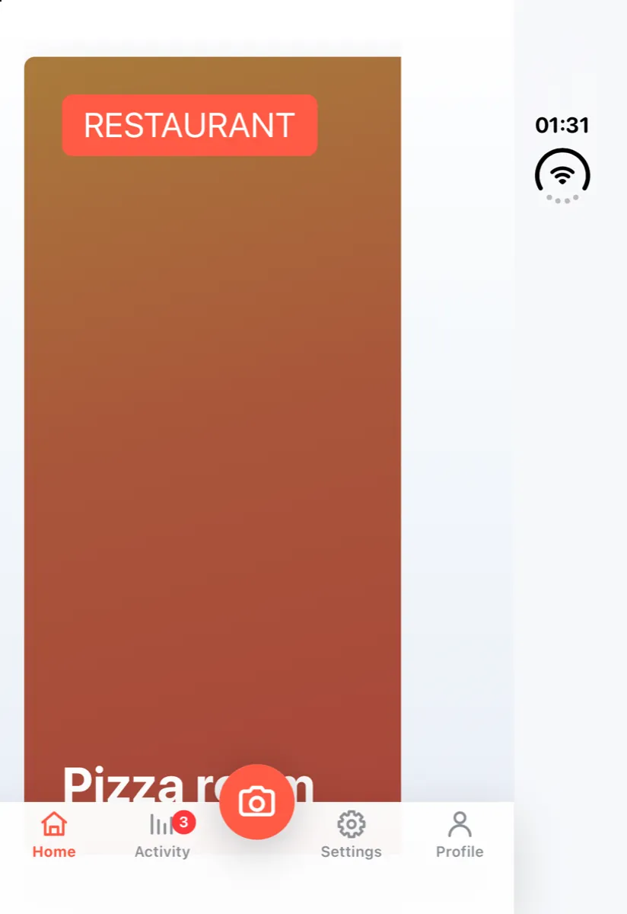     | 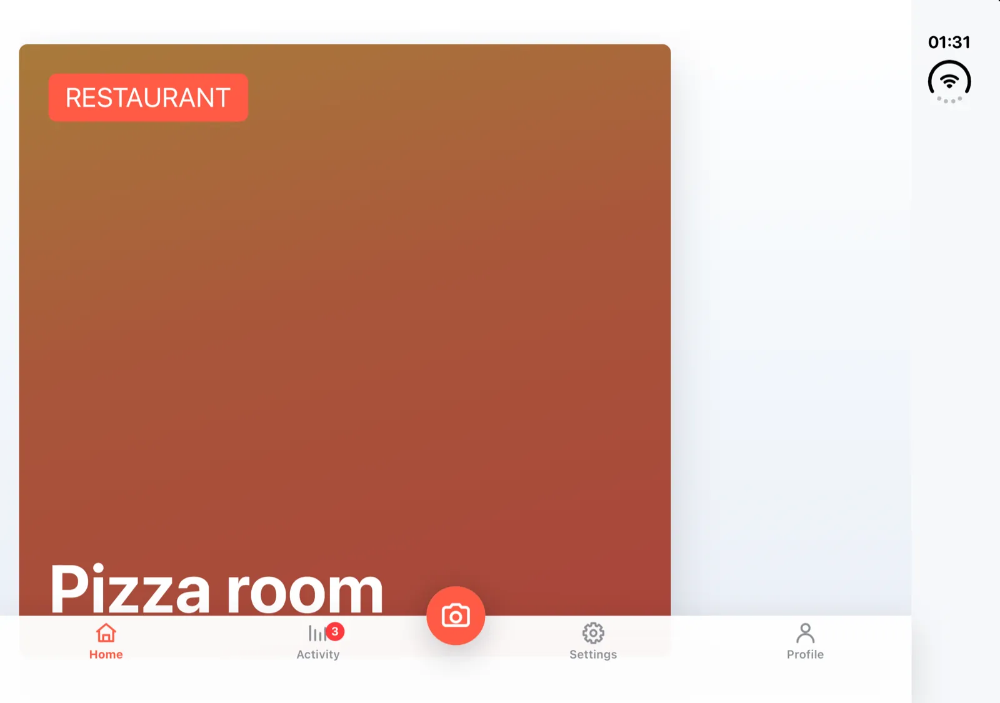            | 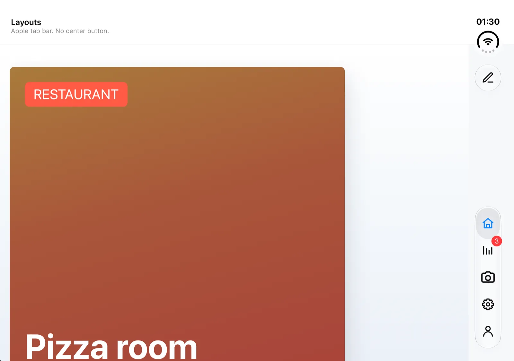                  | 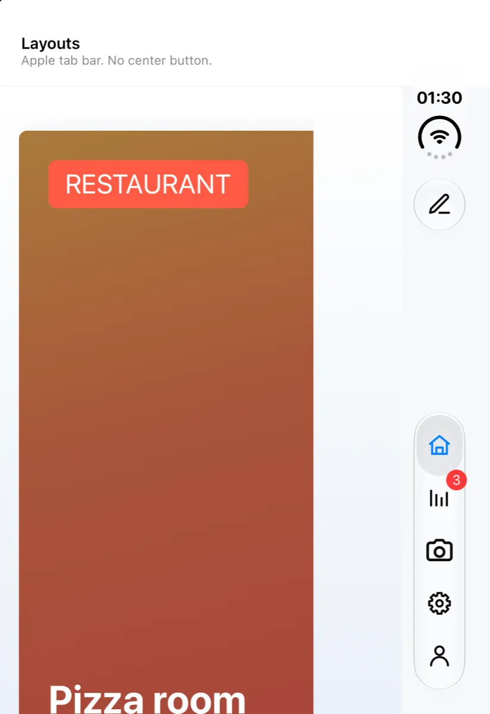                            |

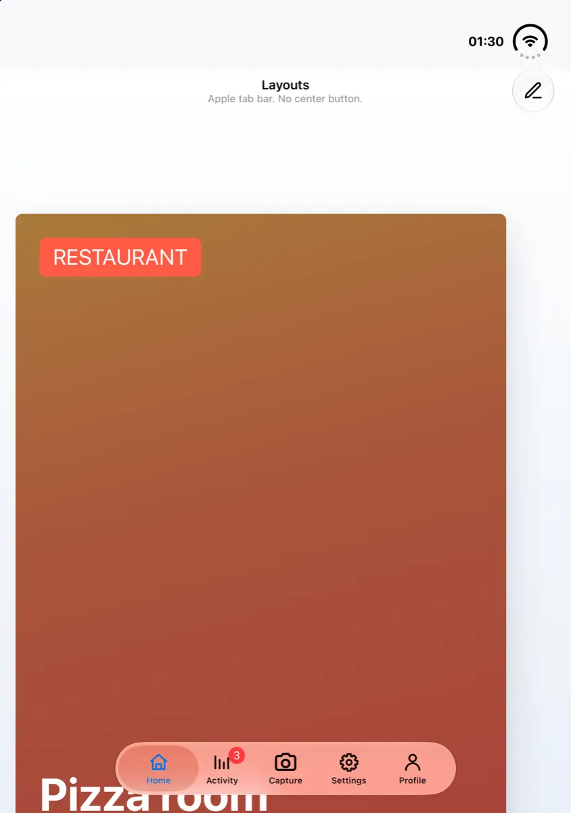

Open landscape with the navbar controls in the rail. The back icon sits under the status items, Done is a prominent text button, reply and forward share one group, and search is a detached button. The system tabs stay at the bottom of the rail.

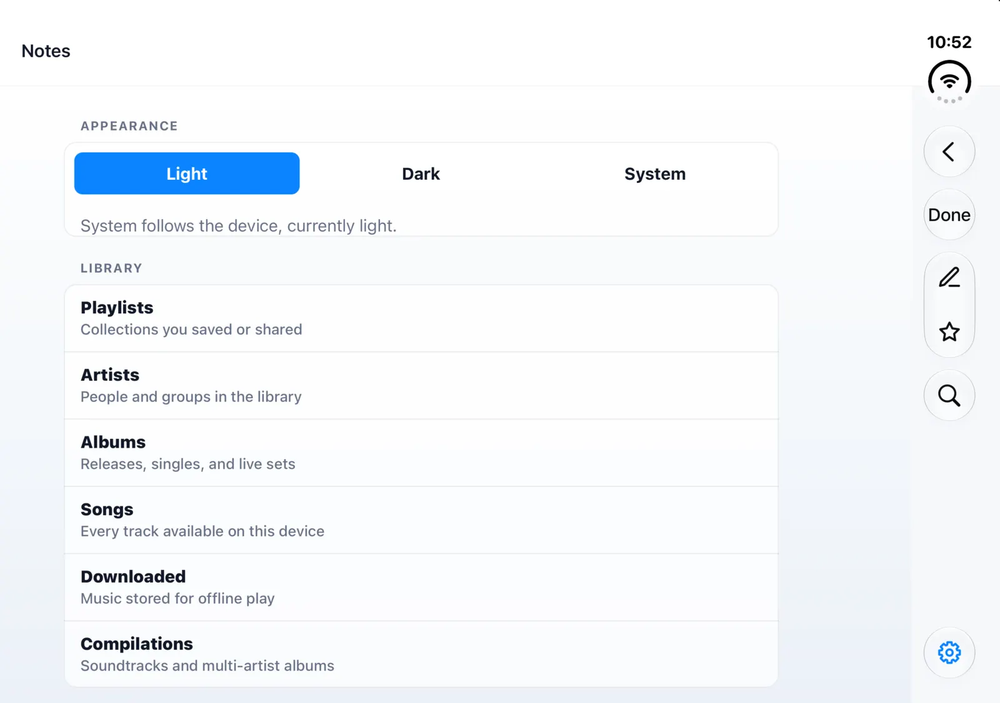

### Navbar segment rows

Multi-level native segment rows under the navbar: a scope switcher on top, section chips below it. See [Navbar segment rows](#navbar-segment-rows-multi-level-top-bar).

| iOS                                                                                                                                                                                                 | Android                                                                                                                                                                                         |
| --------------------------------------------------------------------------------------------------------------------------------------------------------------------------------------------------- | ----------------------------------------------------------------------------------------------------------------------------------------------------------------------------------------------- |
| 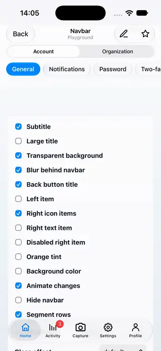 | 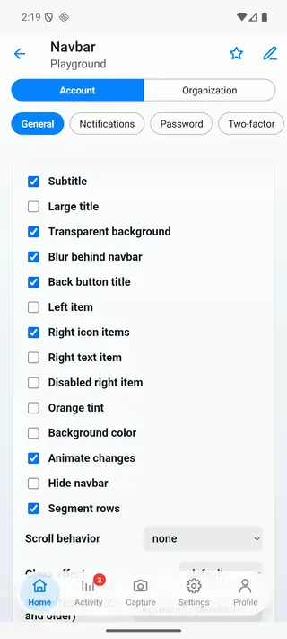 |

### Pull to refresh

Opt-in native pull-to-refresh, shown below the navbar. It works whether the page scrolls `window` or an inner root such as `#app`.

| iOS                                                                                                         | Android                                                                                                                         |
| ----------------------------------------------------------------------------------------------------------- | ------------------------------------------------------------------------------------------------------------------------------- |
| 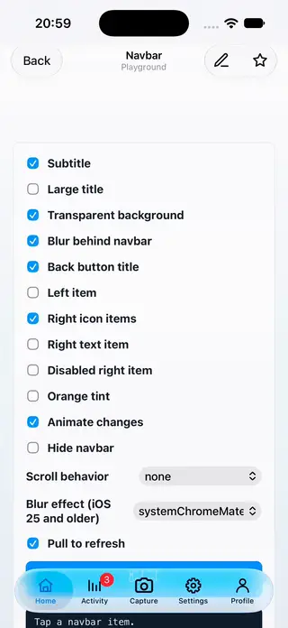 | 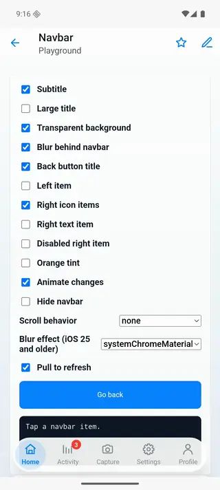 |

```ts
await NativeNavigation.setPullToRefresh({ enabled: true });
NativeNavigation.addListener('pullToRefresh', async () => {
  await reloadData();
  await NativeNavigation.endPullToRefresh();
});
```

## Features

- Drive native top navigation and bottom tabs from JavaScript state.
- Show a native search field under the navbar with `setNavbar({ search })`. It collapses with a large title and reports `navbarSearch`.
- Align a floating tab bar to the start, center, or end, and place the same tabs in a trailing sidebar rail.
- Use system-owned iOS navigation bars, tab bars, tab gestures, and Liquid Glass rendering.
- Emit native intent events such as `navbarBack`, `navbarItemTap`, `navbarSearch`, and `tabSelect`.
- Enable an optional Android Liquid Glass-style translucent surface for native bars (pair it with a CSS `backdrop-filter` for blur).
- Capture WebView snapshots for native-feeling push, back, root, tab, and zoom transitions.
- Configure tab labels, selected icons, badges, indicators, ripples, tint colors, and dynamic colors.
- Write CSS inset variables so web content can scroll behind native bars without being hidden.
- On iPhone Duo, follow the system vertical rail: navbar items join it, safe areas clear it, and a screen can opt out.
- Stack multi-level native segment rows under the navbar (scope switcher plus section tabs) with `setNavbar({ segments })`.
- Opt into native pull-to-refresh (system spinner and haptic on iOS, `SwipeRefreshLayout` on Android) with `setPullToRefresh()`.
- Hide the navbar and tabbar while a web modal, sheet, or popover is open. An animated tabbar hide keeps the iOS tab controller and WebView in place.
- Work with React, Vue, Angular, Svelte, Solid, vanilla JS, and any router that exposes imperative navigation.

## Choose a surface

| Surface | Use it for |
| --- | --- |
| Navbar search | Filter the page under a large title, as in Settings or a library. |
| Segment rows | Switch scope and section on the current screen. |
| Floating bar, center | The default phone tab bar. |
| Floating bar, start or end | A short bar sitting toward one side. |
| Sidebar | The same tabs as a trailing rail on iPad, iPhone Duo, and Android. |
| Curve | A bottom bar with a raised center action. It stays on the bottom. |

## How It Fits

- Your router still owns route state and page rendering.
- The app still uses one full-screen WebView.
- Icons must be serializable descriptors such as SVG strings, SF Symbols, or native resource names.

## Modals, sheets, and popovers

Native bars are drawn above the WebView. A modal, sheet, dialog, or popover from the page (`ion-modal`, `ion-popover`, `<dialog>`, a menu) renders inside that WebView, so it stays underneath the navbar and the tabbar.

Hide each bar the overlay would meet, then send the same options again when the overlay closes. Count open overlays when they can stack. The inner dismiss has to leave the bars hidden while an outer overlay is still up.

```typescript
let overlayCount = 0;

let navbar = {
  title: 'Home',
  backButton: { visible: false },
};

let tabbar = {
  selectedId: 'home',
  tabs: [
    { id: 'home', title: 'Home' },
    { id: 'settings', title: 'Settings' },
  ],
};

async function suspendNativeChrome() {
  overlayCount += 1;
  if (overlayCount > 1) {
    return;
  }

  await NativeNavigation.setNavbar({ ...navbar, hidden: true });
  await NativeNavigation.setTabbar({ ...tabbar, hidden: true, animated: true });
}

async function resumeNativeChrome() {
  overlayCount = Math.max(0, overlayCount - 1);
  if (overlayCount > 0) {
    return;
  }

  await NativeNavigation.setNavbar({ ...navbar, hidden: false });
  await NativeNavigation.setTabbar({ ...tabbar, hidden: false, animated: true });
}
```

Keep `navbar` and `tabbar` as the options for the current route, and update them in the same place you already call `setNavbar` and `setTabbar`. Call `suspendNativeChrome()` before the overlay presents (`ionModalWillPresent`, `ionPopoverWillPresent`, or the line before `dialog.showModal()`). Call `resumeNativeChrome()` after it is gone (`ionModalDidDismiss`, `ionPopoverDidDismiss`, or the dialog `close` event).

`setTabbar({ hidden: false })` without `tabs` clears the bar. Spread the last options you rendered and change `hidden`.

Pass `animated: true` on that tabbar toggle:

- **iOS 26+ system Liquid Glass**, when `shape` is not `curve` and `minimizeBehavior` is not `onScrollDown`. The plugin calls `UITabBarController.setTabBarHidden(_:animated:)`. The tab controller stays mounted and the WebView stays hosted in it. UIKit fades the bar. `animated: false` on this bar tears the controller down and moves the WebView back to the bridge, which runs during the modal's own animation.
- **Earlier iOS, the curved bar, and the minimize-on-scroll capsule.** The bar fades over 200ms and stays mounted.
- **Android.** The bar and its backdrop slide and fade over 200ms, then leave the layout. Showing them plays that in reverse. A later `setTabbar` on a bar that is already visible does not replay the slide-in.

The navbar hide is immediate on iOS and Android. `animated` on `setNavbar` applies to title and button changes while the bar is visible.

Insets update when the call resolves, while the tabbar animation is still running:

- A hidden navbar sets `--cap-native-navigation-top` and `--cap-native-navbar-height` to `0`. Scroll-linked navbar changes wait until the next `setNavbar` that shows the bar.
- A hidden Android tabbar sets `--cap-native-navigation-bottom` and `--cap-native-tabbar-height` to `0`, so the overlay can use the space the bar is leaving.
- On the iOS 26+ system tab bar, `--cap-native-tabbar-height` is already `0`: the WebView is hosted inside the tab and does not extend under the bar. An animated hide keeps `--cap-native-system-tabbar-height` at the nominal bar height (bar plus home-indicator padding). A non-animated hide drops that value as well, because the tab controller is gone.

A popover that stays clear of the bars can leave them up. Hide the navbar for a menu under the title, and the tabbar for a sheet that covers the bottom of the screen.

`configure({ enabled: false })` turns the chrome host off. Use `hidden` for an overlay. On the web there is no native bar; the same calls still update the CSS inset variables.

Keep the modal in this WebView. The overlay is page state, and the router stays in charge of it.

## Compatibility

`@capgo/capacitor-native-navigation` targets Capacitor 8 and Node.js 22+. iOS 27 is supported, including iPhone Duo.

## Install

You can use our AI-Assisted Setup to install the plugin. Add the Capgo skills to your AI tool using the following command:

```bash
npx skills add https://github.com/cap-go/capacitor-skills --skill capacitor-plugins
```

Then use the following prompt:

```text
Use the `capacitor-plugins` skill from `cap-go/capacitor-skills` to install the `@capgo/capacitor-native-navigation` plugin in my project.
```

If you prefer Manual Setup, install the plugin by running the following commands and follow the platform-specific instructions below:

```bash
npm install @capgo/capacitor-native-navigation
npx cap sync
```

## Minimal Usage

```typescript
import { NativeNavigation } from '@capgo/capacitor-native-navigation';

await NativeNavigation.configure({
  contentInsetMode: 'css',
  animationDuration: 360,
});

await NativeNavigation.setNavbar({
  title: 'Home',
  subtitle: 'Native chrome',
  transparent: true,
  scrollBehavior: 'both',
  scrollThreshold: 8,
  backButton: { visible: false },
  rightItems: [
    {
      id: 'compose',
      title: 'Compose',
      icon: {
        svg: '<svg viewBox="0 0 24 24" fill="none" stroke="currentColor" stroke-width="2"><path d="M12 20h9"/><path d="M16.5 3.5a2.12 2.12 0 0 1 3 3L7 19l-4 1 1-4Z"/></svg>',
      },
    },
  ],
});

await NativeNavigation.setTabbar({
  selectedId: 'home',
  labelVisibilityMode: 'labeled',
  icons: true,
  colors: {
    dynamic: true,
  },
  tabs: [
    {
      id: 'home',
      title: 'Home',
      icon: {
        svg: '<svg viewBox="0 0 24 24" fill="none" stroke="currentColor" stroke-width="2"><path d="M3 10.5 12 3l9 7.5"/><path d="M5 10v10h14V10"/></svg>',
      },
    },
    {
      id: 'settings',
      title: 'Settings',
      icon: {
        svg: '<svg viewBox="0 0 24 24" fill="none" stroke="currentColor" stroke-width="2"><circle cx="12" cy="12" r="3"/><path d="M12 2v3M12 19v3M2 12h3M19 12h3"/></svg>',
      },
    },
  ],
});

await NativeNavigation.addListener('tabSelect', ({ id }) => {
  router.navigate(`/${id}`);
});
```

## Native Tab Styling

```typescript
await NativeNavigation.setTabbar({
  selectedId: 'home',
  labelVisibilityMode: 'selected',
  indicatorColor: '#0A84FF',
  rippleColor: '#330A84FF',
  badgeBackgroundColor: '#FF3B30',
  badgeTextColor: '#FFFFFF',
  colors: {
    dynamic: true,
    tint: '#0A84FF',
    inactiveTint: '#8E8E93',
  },
  tabs: [
    {
      id: 'home',
      title: 'Home',
      icon: { ios: { sfSymbol: 'house' }, android: { resource: 'ic_home' } },
      selectedIcon: { ios: { sfSymbol: 'house.fill' }, android: { resource: 'ic_home_filled' } },
    },
  ],
});
```

## Android Liquid Glass

On Android 12+, floating tabbars use `liquidGlass` automatically when `setTabbar` omits `glass` (pass `glass: { effect: 'none' }` for a flat fill). Android draws a translucent tint without live blur: rendering the WebView from native code to blur it flashes the page or swallows flings. For blur, place an element with `backdrop-filter: blur(...)` in your page under the bar (the floating tabbar is 64px tall, 24px from the sides, at most 430px wide, 10px above the system navigation bar). Tune `colors.background` alpha and `glass.surfaceAlpha` (default `0.62`) together.

```typescript
await NativeNavigation.configure({
  glass: {
    effect: 'liquidGlass',
    blurRadius: 18,
    surfaceAlpha: 0.62,
  },
});

await NativeNavigation.setTabbar({
  selectedId: 'home',
  tabs,
  colors: {
    background: '#F8FFFFFF',
  },
});
```

## Transition Flow

```typescript
const transition = await NativeNavigation.beginTransition({ direction: 'forward' });

router.navigate('/detail');
await router.ready?.();

await NativeNavigation.setNavbar({
  title: 'Detail',
  backButton: { visible: true, title: 'Back' },
});

await NativeNavigation.finishTransition({
  id: transition.id,
  direction: 'forward',
});
```

## Use With @capgo/capacitor-transitions

Use `@capgo/capacitor-native-navigation` for the native navbar, tabbar, safe-area insets, and native intent events. Use `@capgo/capacitor-transitions` for the WebView page stack underneath that native chrome.

```bash
npm install @capgo/capacitor-native-navigation @capgo/capacitor-transitions
npx cap sync
```

Initialize both packages once when the app starts:

```typescript
import { NativeNavigation } from '@capgo/capacitor-native-navigation';
import '@capgo/capacitor-transitions';
import { initTransitions, setupRouterOutlet, setDirection } from '@capgo/capacitor-transitions/react';

initTransitions({ platform: 'auto' });

const outlet = document.querySelector('cap-router-outlet');
if (outlet) {
  setupRouterOutlet(outlet, { platform: 'auto', swipeGesture: 'auto' });
}

await NativeNavigation.configure({
  contentInsetMode: 'css',
});
```

Keep the transition outlet focused on pages. Do not render a web header or footer when native chrome owns those surfaces:

```html
<cap-router-outlet platform="auto" swipe-gesture="auto">
  <cap-page>
    <cap-content slot="content" fullscreen>
      <main class="page">Inbox content</main>
    </cap-content>
  </cap-page>
</cap-router-outlet>
```

```css
.page {
  min-height: 100dvh;
  padding-top: var(--cap-native-navigation-top);
  padding-bottom: var(--cap-native-navigation-bottom);
}
```

Drive both packages from the same router actions:

```typescript
async function openMessage(id: string) {
  setDirection('forward');
  await router.push(`/messages/${id}`);
  await NativeNavigation.setNavbar({
    title: 'Message',
    backButton: { visible: true, title: 'Inbox' },
  });
}

await NativeNavigation.addListener('navbarBack', () => {
  setDirection('back');
  router.back();
});

await NativeNavigation.addListener('tabSelect', ({ id }) => {
  setDirection('root');
  router.push(`/${id}`);
});
```

Pick one animation layer per navigation. For normal route pushes, let `@capgo/capacitor-transitions` animate the WebView pages and update native bars with `setNavbar` / `setTabbar`. For shared-element or zoom routes, use `beginZoomTransition` / `finishZoomTransition` from this plugin and skip the web page transition for that navigation.

## Scroll-driven navbar

Opt in per screen with `setNavbar({ scrollBehavior: 'both' })`. Defaults stay `none`, so existing apps keep static chrome. Native iOS and Android listen to scroll on `window`, `#app`, and any element marked with `data-cap-native-navigation-scroll`. Use `reportNavbarScroll()` only for custom scroll roots.

The example app route **Scroll header demo** (home tile) shows a long list with `scrollBehavior: 'both'`. Scroll down to hide the bar. Scroll up to bring it back before the list reaches the top.

| At rest                                                                                                                                      | Hide, then reveal                                                                                                                                                                              |
| -------------------------------------------------------------------------------------------------------------------------------------------- | ---------------------------------------------------------------------------------------------------------------------------------------------------------------------------------------------- |
| 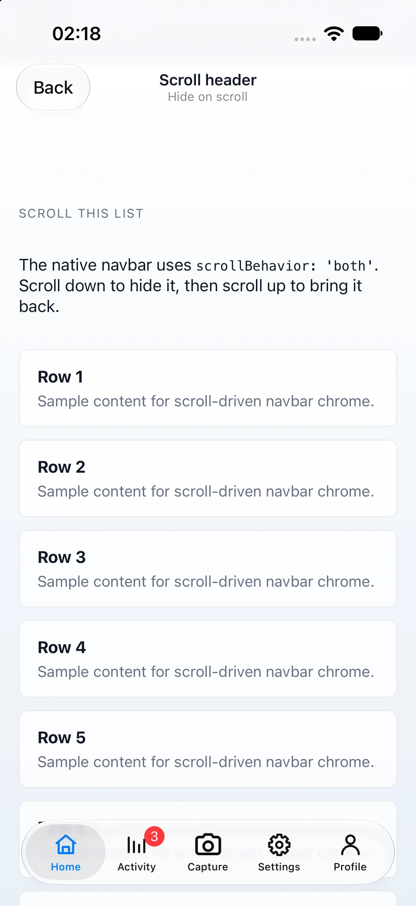                             | 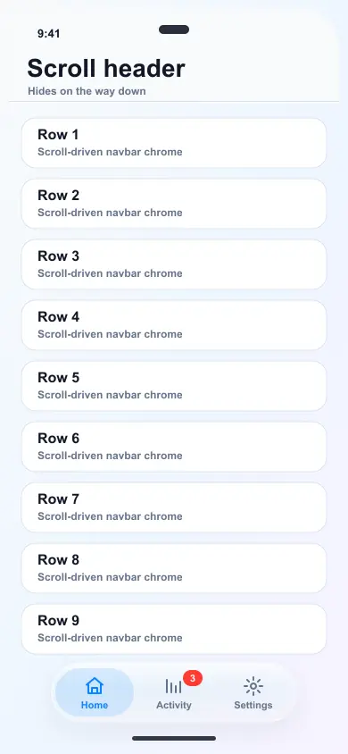                                       |

## Navbar search

Pass `search` to `setNavbar` to draw a native field under the bar and above any segment rows. The row is 52pt on iOS and 52dp on Android, and that height is included in the top inset. iOS uses a `UISearchBar`. Android uses a text field. The web preview draws the same field above the page.

`hidesWhenCollapsed` defaults to `true` when the navbar is a large title. Once that title collapses, the row height becomes 0 and the top inset shrinks with it. On the web preview the field hides with the navbar when scroll behavior collapses the bar. Large-title collapse itself is native.

```typescript
import { NativeNavigation } from '@capgo/capacitor-native-navigation';

let query = '';

const renderNavbar = () =>
  NativeNavigation.setNavbar({
    title: 'Settings',
    large: true,
    search: {
      placeholder: 'Search',
      text: query,
      hidesWhenCollapsed: true,
    },
  });

await NativeNavigation.addListener('navbarSearch', async ({ text, reason }) => {
  query = reason === 'cancel' ? '' : text;
  await renderNavbar();
});

await renderNavbar();
```

Send the latest `text` on the next `setNavbar` so the field stays in sync. While the field is focused, an unchanged `text` is left alone. On iOS and Android, omitting `search` removes the field. The web implementation keeps the previous `search` object when the call omits it, so pass `search: { hidden: true }` to clear it there too.

The example **Settings** tab uses this field to filter an inset grouped list, and its appearance control switches the demo between light, dark, and the system scheme. The **Navbar** playground has a **Search field** toggle.

iPhone 17 simulator, iOS 27.0.

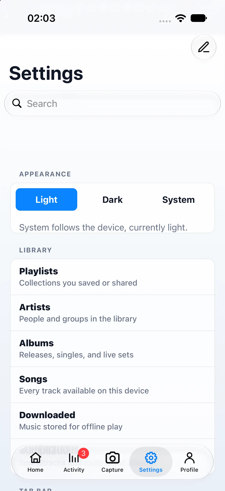
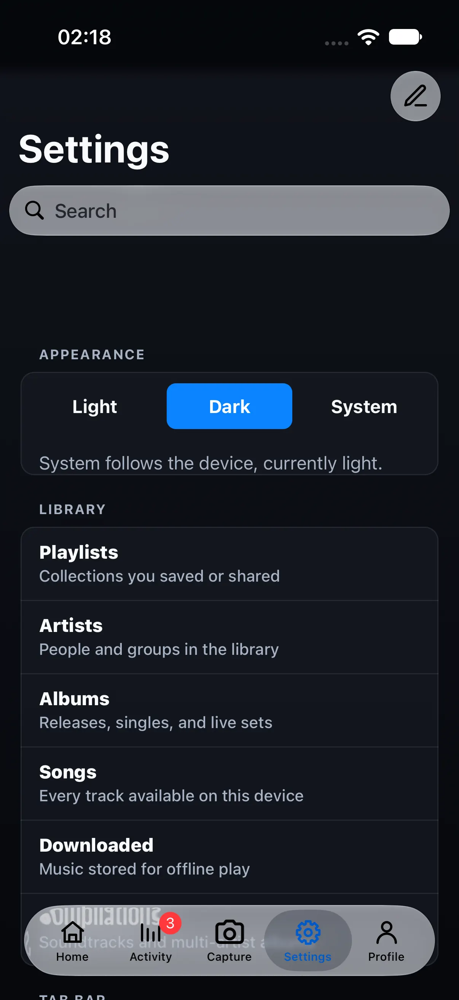

## Tab bar placement and alignment

`style.alignment` places a floating bar inside the horizontal margin: `start`, `center` (the default), or `end`. `start` and `end` follow `layoutDirection`. Curve bars and sidebar rails ignore alignment.

`style.placement` chooses the chrome:

- `auto` lets iOS 18 and newer decide. Compact iPhone stays on the bottom. iPad and iPhone Duo can use the trailing sidebar.
- `bottom` keeps a bottom bar.
- `sidebar` asks for the trailing rail. On iOS 18 and newer that is the system tab bar in sidebar mode, including on iOS 18 through 25. iPad portrait shows that mode as a top tab bar with the sidebar button. A compact iPhone may stay on the bottom when UIKit does not offer a sidebar. Android draws an 84dp rail, inset 12dp from the trailing edge, starting below the navbar. The navbar stays full width. The web preview reports the same left or right inset.

`curve` always stays on the bottom. `sidebar` ignores `minimizeBehavior` and drag-to-select.

```typescript
await NativeNavigation.setTabbar({
  tabs,
  selectedId: 'home',
  style: {
    shape: 'floating',
    alignment: 'end',
    placement: 'bottom',
  },
});

await NativeNavigation.setTabbar({
  tabs,
  selectedId: 'home',
  style: {
    shape: 'floating',
    placement: 'sidebar',
  },
});
```

The example **Tabbar** playground and the **Settings** tab both expose alignment and placement. Pad page content with `--cap-native-navigation-left` and `--cap-native-navigation-right` so a rail does not cover it.

iPad Pro 11-inch simulator, iOS 27.0. Alignment moves the floating capsule; the iOS 26 system tab bar does not. Sidebar placement uses UIKit's top tab bar and sidebar button.

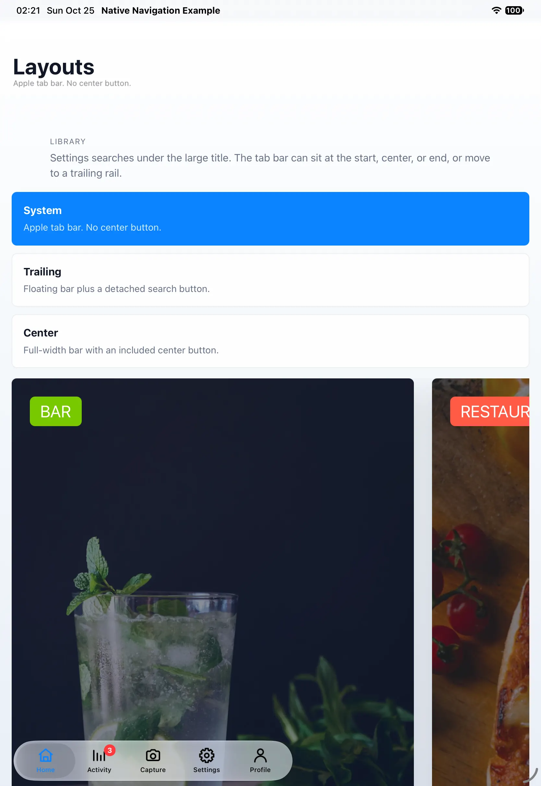
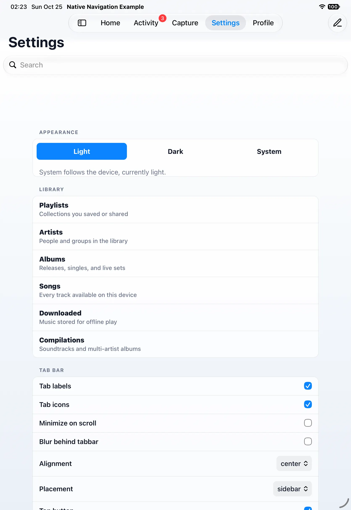

## Navbar segment rows (multi-level top bar)

Pass `segments` to `setNavbar` to stack rows of native segments under the bar, such as a scope switcher on top and section tabs below it. Rows draw top to bottom, each one adds 44pt (iOS) or 48dp (Android) to the navbar and to the reported insets. iOS uses `UISegmentedControl` / glass pills, Android uses Material segmented buttons and filter chips.

```typescript
import { NativeNavigation } from '@capgo/capacitor-native-navigation';

const sections = {
  account: ['General', 'Notifications', 'Password', 'Two-factor'],
  organization: ['General', 'Members', 'Plans', 'Usage', 'Credits', 'Billing', 'Security', 'Webhooks'],
};
const selection = { scope: 'account', section: 'general' };

const renderNavbar = () =>
  NativeNavigation.setNavbar({
    title: 'Settings',
    segments: [
      {
        id: 'scope',
        selectedId: selection.scope,
        items: [
          { id: 'account', title: 'Account' },
          { id: 'organization', title: 'Organization' },
        ],
      },
      {
        id: 'section',
        style: 'scroll', // horizontally scrolling chips; `auto` picks `segmented` for up to 4 items
        selectedId: selection.section,
        items: sections[selection.scope].map((title) => ({ id: title.toLowerCase(), title })),
      },
    ],
  });

await NativeNavigation.addListener('navbarSegmentSelect', async ({ groupId, id }) => {
  if (groupId === 'scope') {
    selection.scope = id;
    selection.section = 'general'; // the second level depends on the first one
  } else {
    selection.section = id;
  }
  await renderNavbar();
});

await renderNavbar();
```

Selection moves natively when the user taps, but every `setNavbar` call applies `selectedId` again. Keep the selected ids in your state and pass them on every later `setNavbar` call; to reject a selection, send the previous `selectedId`. Items accept `icon`, `accessibilityLabel` and `enabled` like navbar buttons. Pass `segments: []` to remove the rows.

The example app **Navbar** playground has a **Segment rows** toggle with this exact setup.

## Zoom Transition

```typescript
import { beginZoomTransition, finishZoomTransition } from '@capgo/capacitor-native-navigation';

const card = document.querySelector('[data-photo-card]');
if (card) {
  const transition = await beginZoomTransition(card, { cornerRadius: 18 });

  router.navigate('/photo/42');
  await router.ready?.();

  await finishZoomTransition(undefined, {
    id: transition.id,
    cornerRadius: 18,
  });
}
```

## CSS Insets

With `contentInsetMode: 'css'`, the plugin updates these variables on `document.documentElement`:

```css
.app-scroll {
  height: 100dvh;
  overflow: auto;
  padding-top: calc(var(--cap-native-navigation-top) + 24px);
  padding-left: var(--cap-native-navigation-left);
  padding-right: var(--cap-native-navigation-right);
  scroll-padding-bottom: calc(var(--cap-native-navigation-bottom) + 24px);
}

.page {
  min-height: 100dvh;
  padding-bottom: calc(var(--cap-native-navigation-bottom) + 24px);
}
```

Available variables:

- `--cap-native-navigation-top`
- `--cap-native-navigation-right`
- `--cap-native-navigation-bottom`
- `--cap-native-navigation-left`
- `--cap-native-navbar-height`
- `--cap-native-tabbar-height`
- `--cap-native-system-tabbar-height` (nominal tab bar height; use on iOS when `--cap-native-tabbar-height` is `0` for hosted system bars). On an iPhone Duo rail this is the rail thickness, and the overlap is `--cap-native-navigation-left` or `--cap-native-navigation-right`.
- `--cap-native-navigation-vertical-bar-edge` (`leading`, `trailing`, or empty)
- `--cap-native-navigation-division-x` and `--cap-native-navigation-division-width` (the fold, or `0px`)

## Web Components

The package can register optional custom elements for framework-agnostic declarative setup:

```typescript
import { defineNativeNavigationElements } from '@capgo/capacitor-native-navigation';

defineNativeNavigationElements();
```

```html
<cap-native-navigation-provider enabled="true" content-inset-mode="css"></cap-native-navigation-provider>

<cap-native-navbar
  title="Settings"
  large
  search='{"placeholder":"Search","hidesWhenCollapsed":true}'
></cap-native-navbar>

<cap-native-tabbar
  selected-id="home"
  tabs='[{"id":"home","title":"Home","icon":{"ios":{"sfSymbol":"house.fill"}}}]'
  tabbar-style='{"shape":"floating","alignment":"center","placement":"auto"}'
></cap-native-tabbar>
```

## Icon Descriptors

```typescript
const icon = {
  svg: '<svg viewBox="0 0 24 24" fill="none" stroke="currentColor" stroke-width="2"><path d="M3 10.5 12 3l9 7.5"/></svg>',
  width: 24,
  height: 24,
  template: true,
  src: 'shared_asset_name',
  ios: {
    svg: '<svg viewBox="0 0 24 24"><path d="M3 10.5 12 3l9 7.5"/></svg>',
    sfSymbol: 'house.fill',
    image: 'BundledAssetName',
  },
  android: {
    svg: '<svg viewBox="0 0 24 24"><path d="M3 10.5 12 3l9 7.5"/></svg>',
    resource: 'ic_menu_view',
    image: 'bundled_drawable_name',
  },
};
```

Inline SVG supports the icon-focused subset used by common sets such as Lucide and Feather: `path`, `line`, `polyline`, `polygon`, `circle`, and `rect`. The SVG is rendered as a template image by default, so native tint colors can recolor it without bundling a platform asset.

## Platform Notes

- iOS uses UIKit `UINavigationBar`, `UISearchBar`, `UITabBar`, and `UITabBarController` so the system owns tab interaction, Liquid Glass rendering, sidebar placement on iOS 18+, and safe-area behavior.
- Android uses an AppCompat `Toolbar`, a text field under that toolbar, and a native tab surface. Sidebar placement is a trailing rail. The navbar stays full width.
- Web mirrors inset variables, the search field, sidebar insets, floating-bar alignment, and events for local development.

## Example App

The `example-app/` folder is a vanilla JS Capacitor demo linked with `file:..`.

```bash
cd example-app
npm install
npm run build
npx cap add ios
npx cap add android
npx cap sync
```

## API

<docgen-index>

* [`configure(...)`](#configure)
* [`setNavbar(...)`](#setnavbar)
* [`reportNavbarScroll(...)`](#reportnavbarscroll)
* [`setPullToRefresh(...)`](#setpulltorefresh)
* [`endPullToRefresh()`](#endpulltorefresh)
* [`setTabbar(...)`](#settabbar)
* [`beginTransition(...)`](#begintransition)
* [`finishTransition(...)`](#finishtransition)
* [`getPluginVersion()`](#getpluginversion)
* [`addListener('navbarBack', ...)`](#addlistenernavbarback-)
* [`addListener('navbarItemTap', ...)`](#addlistenernavbaritemtap-)
* [`addListener('navbarSearch', ...)`](#addlistenernavbarsearch-)
* [`addListener('navbarSegmentSelect', ...)`](#addlistenernavbarsegmentselect-)
* [`addListener('tabSelect', ...)`](#addlistenertabselect-)
* [`addListener('safeAreaChanged', ...)`](#addlistenersafeareachanged-)
* [`addListener('verticalBarChanged', ...)`](#addlistenerverticalbarchanged-)
* [`addListener('hingeChanged', ...)`](#addlistenerhingechanged-)
* [`addListener('transitionStart', ...)`](#addlistenertransitionstart-)
* [`addListener('transitionEnd', ...)`](#addlistenertransitionend-)
* [`addListener('pullToRefresh', ...)`](#addlistenerpulltorefresh-)
* [Interfaces](#interfaces)
* [Type Aliases](#type-aliases)

</docgen-index>

<docgen-api>
<!--Update the source file JSDoc comments and rerun docgen to update the docs below-->

Framework-agnostic native navigation chrome API.

### configure(...)

```typescript
configure(options?: NativeNavigationConfigureOptions | undefined) => Promise<NativeNavigationInsetsResult>
```

Configure the native chrome host and content inset behavior.

| Param         | Type                                                                                          |
| ------------- | --------------------------------------------------------------------------------------------- |
| **`options`** | <code><a href="#nativenavigationconfigureoptions">NativeNavigationConfigureOptions</a></code> |

**Returns:** <code>Promise&lt;<a href="#nativenavigationinsetsresult">NativeNavigationInsetsResult</a>&gt;</code>

--------------------


### setNavbar(...)

```typescript
setNavbar(options: NativeNavigationNavbarOptions) => Promise<NativeNavigationInsetsResult>
```

Render or update the native navbar.

| Param         | Type                                                                                    |
| ------------- | --------------------------------------------------------------------------------------- |
| **`options`** | <code><a href="#nativenavigationnavbaroptions">NativeNavigationNavbarOptions</a></code> |

**Returns:** <code>Promise&lt;<a href="#nativenavigationinsetsresult">NativeNavigationInsetsResult</a>&gt;</code>

--------------------


### reportNavbarScroll(...)

```typescript
reportNavbarScroll(options: NativeNavigationNavbarScrollEvent) => Promise<void>
```

Report scroll samples for `scrollBehavior`. Use only for scroll roots that
are not already wired by `setNavbar` (`window`, `#app`, or
`[data-cap-native-navigation-scroll]`). iOS, Android, and the web fallback
install those listeners automatically when scrolling is enabled.

| Param         | Type                                                                                            |
| ------------- | ----------------------------------------------------------------------------------------------- |
| **`options`** | <code><a href="#nativenavigationnavbarscrollevent">NativeNavigationNavbarScrollEvent</a></code> |

--------------------


### setPullToRefresh(...)

```typescript
setPullToRefresh(options: NativeNavigationPullToRefreshOptions) => Promise<void>
```

Enable or disable the native pull-to-refresh gesture. Listen for
`pullToRefresh`, reload your data, then call `endPullToRefresh()` to hide
the spinner. No-op on web.

| Param         | Type                                                                                                  |
| ------------- | ----------------------------------------------------------------------------------------------------- |
| **`options`** | <code><a href="#nativenavigationpulltorefreshoptions">NativeNavigationPullToRefreshOptions</a></code> |

**Since:** 8.11.0

--------------------


### endPullToRefresh()

```typescript
endPullToRefresh() => Promise<void>
```

Stop the native pull-to-refresh spinner once the refresh is done.

**Since:** 8.11.0

--------------------


### setTabbar(...)

```typescript
setTabbar(options: NativeNavigationTabbarOptions) => Promise<NativeNavigationInsetsResult>
```

Render or update the native tabbar.

| Param         | Type                                                                                    |
| ------------- | --------------------------------------------------------------------------------------- |
| **`options`** | <code><a href="#nativenavigationtabbaroptions">NativeNavigationTabbarOptions</a></code> |

**Returns:** <code>Promise&lt;<a href="#nativenavigationinsetsresult">NativeNavigationInsetsResult</a>&gt;</code>

--------------------


### beginTransition(...)

```typescript
beginTransition(options?: NativeNavigationBeginTransitionOptions | undefined) => Promise<NativeNavigationTransitionResult>
```

Capture the current WebView and prepare a native transition.

| Param         | Type                                                                                                      |
| ------------- | --------------------------------------------------------------------------------------------------------- |
| **`options`** | <code><a href="#nativenavigationbegintransitionoptions">NativeNavigationBeginTransitionOptions</a></code> |

**Returns:** <code>Promise&lt;<a href="#nativenavigationtransitionresult">NativeNavigationTransitionResult</a>&gt;</code>

--------------------


### finishTransition(...)

```typescript
finishTransition(options?: NativeNavigationFinishTransitionOptions | undefined) => Promise<NativeNavigationTransitionResult>
```

Animate from the captured WebView snapshot to the current live WebView.

| Param         | Type                                                                                                        |
| ------------- | ----------------------------------------------------------------------------------------------------------- |
| **`options`** | <code><a href="#nativenavigationfinishtransitionoptions">NativeNavigationFinishTransitionOptions</a></code> |

**Returns:** <code>Promise&lt;<a href="#nativenavigationtransitionresult">NativeNavigationTransitionResult</a>&gt;</code>

--------------------


### getPluginVersion()

```typescript
getPluginVersion() => Promise<PluginVersionResult>
```

Returns the platform implementation version marker.

**Returns:** <code>Promise&lt;<a href="#pluginversionresult">PluginVersionResult</a>&gt;</code>

--------------------


### addListener('navbarBack', ...)

```typescript
addListener(eventName: 'navbarBack', listenerFunc: (event: NativeNavigationBackEvent) => void) => Promise<PluginListenerHandle>
```

| Param              | Type                                                                                                |
| ------------------ | --------------------------------------------------------------------------------------------------- |
| **`eventName`**    | <code>'navbarBack'</code>                                                                           |
| **`listenerFunc`** | <code>(event: <a href="#nativenavigationbackevent">NativeNavigationBackEvent</a>) =&gt; void</code> |

**Returns:** <code>Promise&lt;<a href="#pluginlistenerhandle">PluginListenerHandle</a>&gt;</code>

--------------------


### addListener('navbarItemTap', ...)

```typescript
addListener(eventName: 'navbarItemTap', listenerFunc: (event: NativeNavigationBarItemTapEvent) => void) => Promise<PluginListenerHandle>
```

| Param              | Type                                                                                                            |
| ------------------ | --------------------------------------------------------------------------------------------------------------- |
| **`eventName`**    | <code>'navbarItemTap'</code>                                                                                    |
| **`listenerFunc`** | <code>(event: <a href="#nativenavigationbaritemtapevent">NativeNavigationBarItemTapEvent</a>) =&gt; void</code> |

**Returns:** <code>Promise&lt;<a href="#pluginlistenerhandle">PluginListenerHandle</a>&gt;</code>

--------------------


### addListener('navbarSearch', ...)

```typescript
addListener(eventName: 'navbarSearch', listenerFunc: (event: NativeNavigationNavbarSearchEvent) => void) => Promise<PluginListenerHandle>
```

Fired when the navbar search field changes.

| Param              | Type                                                                                                                |
| ------------------ | ------------------------------------------------------------------------------------------------------------------- |
| **`eventName`**    | <code>'navbarSearch'</code>                                                                                         |
| **`listenerFunc`** | <code>(event: <a href="#nativenavigationnavbarsearchevent">NativeNavigationNavbarSearchEvent</a>) =&gt; void</code> |

**Returns:** <code>Promise&lt;<a href="#pluginlistenerhandle">PluginListenerHandle</a>&gt;</code>

**Since:** 8.14.0

--------------------


### addListener('navbarSegmentSelect', ...)

```typescript
addListener(eventName: 'navbarSegmentSelect', listenerFunc: (event: NativeNavigationNavbarSegmentSelectEvent) => void) => Promise<PluginListenerHandle>
```

Fired when the user selects an item in a navbar segment row.

| Param              | Type                                                                                                                              |
| ------------------ | --------------------------------------------------------------------------------------------------------------------------------- |
| **`eventName`**    | <code>'navbarSegmentSelect'</code>                                                                                                |
| **`listenerFunc`** | <code>(event: <a href="#nativenavigationnavbarsegmentselectevent">NativeNavigationNavbarSegmentSelectEvent</a>) =&gt; void</code> |

**Returns:** <code>Promise&lt;<a href="#pluginlistenerhandle">PluginListenerHandle</a>&gt;</code>

**Since:** 8.13.0

--------------------


### addListener('tabSelect', ...)

```typescript
addListener(eventName: 'tabSelect', listenerFunc: (event: NativeNavigationTabSelectEvent) => void) => Promise<PluginListenerHandle>
```

| Param              | Type                                                                                                          |
| ------------------ | ------------------------------------------------------------------------------------------------------------- |
| **`eventName`**    | <code>'tabSelect'</code>                                                                                      |
| **`listenerFunc`** | <code>(event: <a href="#nativenavigationtabselectevent">NativeNavigationTabSelectEvent</a>) =&gt; void</code> |

**Returns:** <code>Promise&lt;<a href="#pluginlistenerhandle">PluginListenerHandle</a>&gt;</code>

--------------------


### addListener('safeAreaChanged', ...)

```typescript
addListener(eventName: 'safeAreaChanged', listenerFunc: (event: NativeNavigationSafeAreaChangedEvent) => void) => Promise<PluginListenerHandle>
```

| Param              | Type                                                                                                                      |
| ------------------ | ------------------------------------------------------------------------------------------------------------------------- |
| **`eventName`**    | <code>'safeAreaChanged'</code>                                                                                            |
| **`listenerFunc`** | <code>(event: <a href="#nativenavigationsafeareachangedevent">NativeNavigationSafeAreaChangedEvent</a>) =&gt; void</code> |

**Returns:** <code>Promise&lt;<a href="#pluginlistenerhandle">PluginListenerHandle</a>&gt;</code>

--------------------


### addListener('verticalBarChanged', ...)

```typescript
addListener(eventName: 'verticalBarChanged', listenerFunc: (event: NativeNavigationVerticalBarChangedEvent) => void) => Promise<PluginListenerHandle>
```

Fired when the iPhone Duo vertical rail appears, disappears, or changes
edge. `safeAreaChanged` carries the same edge on every inset update.

| Param              | Type                                                                                                                            |
| ------------------ | ------------------------------------------------------------------------------------------------------------------------------- |
| **`eventName`**    | <code>'verticalBarChanged'</code>                                                                                               |
| **`listenerFunc`** | <code>(event: <a href="#nativenavigationverticalbarchangedevent">NativeNavigationVerticalBarChangedEvent</a>) =&gt; void</code> |

**Returns:** <code>Promise&lt;<a href="#pluginlistenerhandle">PluginListenerHandle</a>&gt;</code>

**Since:** 8.14.0

--------------------


### addListener('hingeChanged', ...)

```typescript
addListener(eventName: 'hingeChanged', listenerFunc: (event: NativeNavigationHingeChangedEvent) => void) => Promise<PluginListenerHandle>
```

Fired when the iPhone Duo hinge changes, or when hinge updates stop.
Prefer `hinge.status` over `hinge.angle` when a coarse pose is enough.

| Param              | Type                                                                                                                |
| ------------------ | ------------------------------------------------------------------------------------------------------------------- |
| **`eventName`**    | <code>'hingeChanged'</code>                                                                                         |
| **`listenerFunc`** | <code>(event: <a href="#nativenavigationhingechangedevent">NativeNavigationHingeChangedEvent</a>) =&gt; void</code> |

**Returns:** <code>Promise&lt;<a href="#pluginlistenerhandle">PluginListenerHandle</a>&gt;</code>

**Since:** 8.14.0

--------------------


### addListener('transitionStart', ...)

```typescript
addListener(eventName: 'transitionStart', listenerFunc: (event: NativeNavigationTransitionEvent) => void) => Promise<PluginListenerHandle>
```

| Param              | Type                                                                                                            |
| ------------------ | --------------------------------------------------------------------------------------------------------------- |
| **`eventName`**    | <code>'transitionStart'</code>                                                                                  |
| **`listenerFunc`** | <code>(event: <a href="#nativenavigationtransitionevent">NativeNavigationTransitionEvent</a>) =&gt; void</code> |

**Returns:** <code>Promise&lt;<a href="#pluginlistenerhandle">PluginListenerHandle</a>&gt;</code>

--------------------


### addListener('transitionEnd', ...)

```typescript
addListener(eventName: 'transitionEnd', listenerFunc: (event: NativeNavigationTransitionEvent) => void) => Promise<PluginListenerHandle>
```

| Param              | Type                                                                                                            |
| ------------------ | --------------------------------------------------------------------------------------------------------------- |
| **`eventName`**    | <code>'transitionEnd'</code>                                                                                    |
| **`listenerFunc`** | <code>(event: <a href="#nativenavigationtransitionevent">NativeNavigationTransitionEvent</a>) =&gt; void</code> |

**Returns:** <code>Promise&lt;<a href="#pluginlistenerhandle">PluginListenerHandle</a>&gt;</code>

--------------------


### addListener('pullToRefresh', ...)

```typescript
addListener(eventName: 'pullToRefresh', listenerFunc: () => void) => Promise<PluginListenerHandle>
```

Fired when the user pulls to refresh. The spinner keeps spinning until
`endPullToRefresh()` is called.

| Param              | Type                         |
| ------------------ | ---------------------------- |
| **`eventName`**    | <code>'pullToRefresh'</code> |
| **`listenerFunc`** | <code>() =&gt; void</code>   |

**Returns:** <code>Promise&lt;<a href="#pluginlistenerhandle">PluginListenerHandle</a>&gt;</code>

**Since:** 8.11.0

--------------------


### Interfaces


#### NativeNavigationInsetsResult

Returned by methods that may change safe content bounds.

| Prop         | Type                                                                      |
| ------------ | ------------------------------------------------------------------------- |
| **`insets`** | <code><a href="#nativenavigationinsets">NativeNavigationInsets</a></code> |


#### NativeNavigationInsets

Insets exposed to web content.

| Prop                     | Type                                                                                                | Description                                                                                                                                                                                                                                                              | Since  |
| ------------------------ | --------------------------------------------------------------------------------------------------- | ------------------------------------------------------------------------------------------------------------------------------------------------------------------------------------------------------------------------------------------------------------------------ | ------ |
| **`top`**                | <code>number</code>                                                                                 |                                                                                                                                                                                                                                                                          |        |
| **`right`**              | <code>number</code>                                                                                 |                                                                                                                                                                                                                                                                          |        |
| **`bottom`**             | <code>number</code>                                                                                 |                                                                                                                                                                                                                                                                          |        |
| **`left`**               | <code>number</code>                                                                                 |                                                                                                                                                                                                                                                                          |        |
| **`navbarHeight`**       | <code>number</code>                                                                                 |                                                                                                                                                                                                                                                                          |        |
| **`tabbarHeight`**       | <code>number</code>                                                                                 | Bottom overlap inset for web layout when the WebView does not already reserve space for the native tab bar. On iOS 26+ with a system-hosted tab bar this stays `0` so content is not lifted twice.                                                                       |        |
| **`systemTabbarHeight`** | <code>number</code>                                                                                 | Nominal native tab bar height (bar plus home-indicator padding on iOS) even when `tabbarHeight` is `0`. Stays available while the tab bar is soft-hidden with `setTabbar({ hidden: true, animated: true })`.                                                             |        |
| **`verticalBarEdge`**    | <code><a href="#nativenavigationverticalbaredge">NativeNavigationVerticalBarEdge</a> \| null</code> | Semantic edge of the vertical rail, or `null` when the bars are horizontal. On a rail, `left` or `right` carries the rail thickness and `tabbarHeight` stays `0` when the WebView is already beside it. `systemTabbarHeight` is that thickness rather than a bottom bar. | 8.14.0 |
| **`reservedRegions`**    | <code>NativeNavigationReservedRegion[]</code>                                                       | Fold and occlusion rectangles reported by iOS, in the root view's points. Empty when the device has no reserved regions.                                                                                                                                                 | 8.14.0 |
| **`hinge`**              | <code><a href="#nativenavigationhinge">NativeNavigationHinge</a> \| null</code>                     | Latest hinge sample. `null` when the device has no hinge. Angle updates are delivered on `hingeChanged` and are not pushed through this snapshot on every tick.                                                                                                          | 8.14.0 |


#### NativeNavigationReservedRegion

A region iOS reserves inside the window, such as the fold or an occlusion.

| Prop         | Type                                   |
| ------------ | -------------------------------------- |
| **`kind`**   | <code>'division' \| 'occlusion'</code> |
| **`x`**      | <code>number</code>                    |
| **`y`**      | <code>number</code>                    |
| **`width`**  | <code>number</code>                    |
| **`height`** | <code>number</code>                    |
| **`active`** | <code>boolean</code>                   |


#### NativeNavigationHinge

iPhone Duo hinge sample. `angle` is radians.

| Prop         | Type                                                                 |
| ------------ | -------------------------------------------------------------------- |
| **`angle`**  | <code>number</code>                                                  |
| **`status`** | <code>'unknown' \| 'closed' \| 'partiallyOpen' \| 'fullyOpen'</code> |


#### NativeNavigationConfigureOptions

Global plugin configuration.

| Prop                      | Type                                                                                                | Description                                                                                                                                                                                                                                                                                                                                                                                                                                                                                  | Since  |
| ------------------------- | --------------------------------------------------------------------------------------------------- | -------------------------------------------------------------------------------------------------------------------------------------------------------------------------------------------------------------------------------------------------------------------------------------------------------------------------------------------------------------------------------------------------------------------------------------------------------------------------------------------- | ------ |
| **`enabled`**             | <code>boolean</code>                                                                                | Enables or disables the native chrome host.                                                                                                                                                                                                                                                                                                                                                                                                                                                  |        |
| **`platformStyle`**       | <code><a href="#nativenavigationplatformstyle">NativeNavigationPlatformStyle</a></code>             | Native style preference. `auto` uses the current platform.                                                                                                                                                                                                                                                                                                                                                                                                                                   |        |
| **`contentInsetMode`**    | <code><a href="#nativenavigationcontentinsetmode">NativeNavigationContentInsetMode</a></code>       | When `css`, the plugin writes CSS variables on `document.documentElement`.                                                                                                                                                                                                                                                                                                                                                                                                                   |        |
| **`animationDuration`**   | <code>number</code>                                                                                 | Default native transition duration in milliseconds.                                                                                                                                                                                                                                                                                                                                                                                                                                          |        |
| **`colors`**              | <code><a href="#nativenavigationcolors">NativeNavigationColors</a></code>                           | Shared color hints for native bars.                                                                                                                                                                                                                                                                                                                                                                                                                                                          |        |
| **`glass`**               | <code><a href="#nativenavigationglassoptions">NativeNavigationGlassOptions</a></code>               | Shared glass background defaults for native bars.                                                                                                                                                                                                                                                                                                                                                                                                                                            |        |
| **`verticalBarBehavior`** | <code><a href="#nativenavigationverticalbarbehavior">NativeNavigationVerticalBarBehavior</a></code> | iPhone Duo vertical rail. `automatic` lets iOS move the status bar, the system tab bar, and navbar icon buttons into the rail. The title stays horizontal. `disabled` keeps the horizontal bars for a screen that should stay put, such as video or a calculator. The preference starts as `automatic`. Omitting this option on a later `configure` call keeps the current preference, so a screen that selected `disabled` stays disabled until another call passes `automatic`. iOS 27.1+. | 8.14.0 |


#### NativeNavigationColors

Native bar colors. Use CSS-style hex strings (`#RRGGBB` or `#AARRGGBB`).

| Prop                  | Type                 | Description                                                                                                                                                                                                                                                                                    |
| --------------------- | -------------------- | ---------------------------------------------------------------------------------------------------------------------------------------------------------------------------------------------------------------------------------------------------------------------------------------------- |
| **`dynamic`**         | <code>boolean</code> | When `true`, Android 12+ derives unspecified bar colors from Material You system palettes. Explicit color fields still win.                                                                                                                                                                    |
| **`tint`**            | <code>string</code>  | Tint color for active buttons/items.                                                                                                                                                                                                                                                           |
| **`inactiveTint`**    | <code>string</code>  | Color for inactive tab items. Ignored on iOS 26+ unless `experimentalBakedTintColors` is enabled.                                                                                                                                                                                              |
| **`background`**      | <code>string</code>  | Optional background tint. Ignored on iOS 26+ so UIKit can preserve the system Liquid Glass navigation appearance. On Android, alpha is honored. When `glass.effect` is not `liquidGlass`, floating tabbars still apply `glass.surfaceAlpha` (from `configure` / `setTabbar`) to the fill tint. |
| **`foreground`**      | <code>string</code>  | Title and label text color where the native platform supports it.                                                                                                                                                                                                                              |
| **`badgeBackground`** | <code>string</code>  | Badge background color for native tab badges.                                                                                                                                                                                                                                                  |
| **`badgeText`**       | <code>string</code>  | Badge text color for native tab badges.                                                                                                                                                                                                                                                        |
| **`indicator`**       | <code>string</code>  | Active tab indicator color on Android.                                                                                                                                                                                                                                                         |
| **`ripple`**          | <code>string</code>  | Tab press ripple color on Android.                                                                                                                                                                                                                                                             |


#### NativeNavigationGlassOptions

Native glass background configuration.

| Prop               | Type                                                                                | Description                                                                                                                                                                                                                                                           |
| ------------------ | ----------------------------------------------------------------------------------- | --------------------------------------------------------------------------------------------------------------------------------------------------------------------------------------------------------------------------------------------------------------------- |
| **`effect`**       | <code><a href="#nativenavigationglasseffect">NativeNavigationGlassEffect</a></code> | `liquidGlass` gives native bars a translucent tint surface on Android (no live blur: sampling the WebView from native code breaks its scrolling, so put a CSS `backdrop-filter` under the bar when you want blur). iOS uses the platform-owned Liquid Glass behavior. |
| **`blurRadius`**   | <code>number</code>                                                                 | Blur radius in native dp for `liquidGlass`. Defaults to `18`. Currently unused: Android draws no live blur.                                                                                                                                                           |
| **`surfaceAlpha`** | <code>number</code>                                                                 | Alpha multiplier for the tint surface over the glass backdrop. Defaults to `0.62`. Ignored on Android 11 and older, where bars are always solid.                                                                                                                      |


#### NativeNavigationNavbarOptions

Native navbar state.

| Prop                         | Type                                                                                                      | Description                                                                                                                                                                                                                                                                                                                                                                                                                                                  | Since  |
| ---------------------------- | --------------------------------------------------------------------------------------------------------- | ------------------------------------------------------------------------------------------------------------------------------------------------------------------------------------------------------------------------------------------------------------------------------------------------------------------------------------------------------------------------------------------------------------------------------------------------------------ | ------ |
| **`hidden`**                 | <code>boolean</code>                                                                                      | Hide the native navbar. A web modal, sheet, dialog, or popover renders inside the WebView and stays under this bar, so hide the navbar while that overlay is open. Send the same options again with `hidden: false` when it closes. The hide is immediate on iOS and Android.                                                                                                                                                                                |        |
| **`title`**                  | <code>string</code>                                                                                       | Main title.                                                                                                                                                                                                                                                                                                                                                                                                                                                  |        |
| **`subtitle`**               | <code>string</code>                                                                                       | Secondary title where supported by the platform.                                                                                                                                                                                                                                                                                                                                                                                                             |        |
| **`large`**                  | <code>boolean</code>                                                                                      | Show a large title under the bar, like iOS large titles. On Android the bar grows by 52dp and the title moves into its own row. Send `large: false` with the same title to collapse it to the inline title (animated on Android), e.g. once the page scrolls.                                                                                                                                                                                                |        |
| **`transparent`**            | <code>boolean</code>                                                                                      | Prefer transparent/scroll-edge style.                                                                                                                                                                                                                                                                                                                                                                                                                        |        |
| **`blurEffect`**             | <code><a href="#nativenavigationblureffect">NativeNavigationBlurEffect</a></code>                         | iOS blur/material effect for the navbar background when glass is not available. Defaults to `systemChromeMaterial` for transparent bars.                                                                                                                                                                                                                                                                                                                     |        |
| **`glass`**                  | <code><a href="#nativenavigationglassoptions">NativeNavigationGlassOptions</a></code>                     | Optional glass background behavior. Overrides `configure({ glass })` for this navbar update.                                                                                                                                                                                                                                                                                                                                                                 |        |
| **`edgeBlur`**               | <code>boolean</code>                                                                                      | Progressive blur that fades out below the navbar, drawn by the page with CSS `backdrop-filter` so it follows web scrolling. Not drawn on Android 11 and older. Defaults to `true` on iOS 26+, where the clear Liquid Glass navbar needs it to match the system scroll edge effect, and `false` elsewhere.                                                                                                                                                    |        |
| **`backButton`**             | <code><a href="#nativenavigationbackbutton">NativeNavigationBackButton</a></code>                         | Back button state.                                                                                                                                                                                                                                                                                                                                                                                                                                           |        |
| **`verticalBarCompression`** | <code><a href="#nativenavigationverticalbarcompression">NativeNavigationVerticalBarCompression</a></code> | Which side of the iPhone Duo rail compresses first when space runs out. Omitted means `automatic`. This is separate from `configure({ verticalBarBehavior })`. iOS 27.1+.                                                                                                                                                                                                                                                                                    | 8.14.0 |
| **`leftItems`**              | <code>NativeNavigationBarButton[]</code>                                                                  | Left-side action buttons.                                                                                                                                                                                                                                                                                                                                                                                                                                    |        |
| **`rightItems`**             | <code>NativeNavigationBarButton[]</code>                                                                  | Right-side action buttons.                                                                                                                                                                                                                                                                                                                                                                                                                                   |        |
| **`search`**                 | <code><a href="#nativenavigationnavbarsearch">NativeNavigationNavbarSearch</a></code>                     | Search field under the title. The row adds 52pt (iOS) or 52dp (Android) to the navbar and to the reported top inset while it is visible. Pass `hidden: true` to remove it. Typing fires `navbarSearch`.                                                                                                                                                                                                                                                      | 8.14.0 |
| **`segments`**               | <code>NativeNavigationNavbarSegmentGroup[]</code>                                                         | Rows of native segments drawn under the bar, top to bottom. Each row adds 44pt (iOS) or 48dp (Android) to the navbar and to the reported insets. Selecting an item fires `navbarSegmentSelect` and moves the selection natively. Each `setNavbar` call applies `selectedId` again, so store the selected id from the event and pass it on every later `setNavbar` call. To reject a selection, send the previous `selectedId`.                               | 8.13.0 |
| **`colors`**                 | <code><a href="#nativenavigationcolors">NativeNavigationColors</a></code>                                 | Navbar color hints.                                                                                                                                                                                                                                                                                                                                                                                                                                          |        |
| **`animated`**               | <code>boolean</code>                                                                                      | Animate navbar title and item changes while the bar is visible. Hiding the bar with `hidden: true` does not use this flag.                                                                                                                                                                                                                                                                                                                                   |        |
| **`scrollBehavior`**         | <code><a href="#nativenavigationnavbarscrollbehavior">NativeNavigationNavbarScrollBehavior</a></code>     | Hide or reveal the navbar while web content scrolls. When enabled, iOS and Android inject scroll listeners on `window`, `#app`, and any existing `[data-cap-native-navigation-scroll]` elements, and rescan marked elements on each `setNavbar` call. The web fallback binds the same roots when `setNavbar` runs (`window`, `#app`, and matching marked elements). Do not call `reportNavbarScroll()` for a root that is already bound. Defaults to `none`. |        |
| **`scrollThreshold`**        | <code>number</code>                                                                                       | Minimum vertical scroll delta (CSS px) before `scrollBehavior` reacts. Defaults to `8`.                                                                                                                                                                                                                                                                                                                                                                      |        |
| **`resetScrollCollapsed`**   | <code>boolean</code>                                                                                      | When `true`, clears any scroll-collapsed navbar state before applying this update. Use on route changes; omit for same-screen chrome tweaks.                                                                                                                                                                                                                                                                                                                 |        |


#### NativeNavigationBackButton

Native back button configuration.

| Prop              | Type                                                                                            | Description                                                                                                                                                                                                                                                                                                                                                                                                                                        | Since  |
| ----------------- | ----------------------------------------------------------------------------------------------- | -------------------------------------------------------------------------------------------------------------------------------------------------------------------------------------------------------------------------------------------------------------------------------------------------------------------------------------------------------------------------------------------------------------------------------------------------- | ------ |
| **`visible`**     | <code>boolean</code>                                                                            | Show the native back affordance.                                                                                                                                                                                                                                                                                                                                                                                                                   |        |
| **`title`**       | <code>string</code>                                                                             | Optional back title. This is the accessibility label when the control is an icon. When `display` is omitted, a non-empty title (including the default `Back`) is drawn as text and stays off the iPhone Duo rail.                                                                                                                                                                                                                                  |        |
| **`role`**        | <code><a href="#nativenavigationbackbuttonrole">NativeNavigationBackButtonRole</a></code>       | `back` (the default) is a chevron. `close` is an xmark. An icon sits at the top of the iPhone Duo rail. Android uses the back arrow, or a close icon when `role` is `close`.                                                                                                                                                                                                                                                                       | 8.14.0 |
| **`display`**     | <code><a href="#nativenavigationbackbuttondisplay">NativeNavigationBackButtonDisplay</a></code> | `icon` draws a symbol and can join the iPhone Duo rail. `title` draws text and stays horizontal. When omitted, `close` is an icon, an empty title is an icon, and any other title is text.                                                                                                                                                                                                                                                         | 8.14.0 |
| **`supplements`** | <code>boolean</code>                                                                            | When `true`, `leftItems` are kept beside the system back button. Omitted means `false`. The plugin's back control is its own leading item, so this does not hide `leftItems` on iOS. On Android, `leftItems` are shown with a visible back button only when this is `true`. When no back button is visible, the first `leftItems` entry with an icon uses the toolbar navigation slot (leading edge); further left items stay in the toolbar menu. | 8.14.0 |


#### NativeNavigationBarButton

A button shown in the native navbar.

| Prop          | Type                                                                                    | Description                                                                                                                                                                                                                                                               | Since  |
| ------------- | --------------------------------------------------------------------------------------- | ------------------------------------------------------------------------------------------------------------------------------------------------------------------------------------------------------------------------------------------------------------------------- | ------ |
| **`id`**      | <code>string</code>                                                                     | Stable id returned in `navbarItemTap`.                                                                                                                                                                                                                                    |        |
| **`title`**   | <code>string</code>                                                                     | Visible text label.                                                                                                                                                                                                                                                       |        |
| **`icon`**    | <code><a href="#nativenavigationicon">NativeNavigationIcon</a></code>                   | Native icon descriptor.                                                                                                                                                                                                                                                   |        |
| **`enabled`** | <code>boolean</code>                                                                    | Whether the action is enabled. Defaults to `true`.                                                                                                                                                                                                                        |        |
| **`dock`**    | <code><a href="#nativenavigationbarbuttondock">NativeNavigationBarButtonDock</a></code> | How the button sits in the bar. `shared` (the default) joins the system group. `detached` draws it alone, outside that group, on iOS 26 and later. `prominent` pins it past overflow and search, such as Done. Android keeps every dock value in the normal toolbar menu. | 8.14.0 |
| **`group`**   | <code>string</code>                                                                     | Items that share a group id collapse into one control. The first item is what you see; the system expands the rest. One item stays a normal button. Detached and prominent buttons ignore `group`. iOS 16 and later. Older systems show every item.                       | 8.14.0 |
| **`axis`**    | <code><a href="#nativenavigationbarbuttonaxis">NativeNavigationBarButtonAxis</a></code> | Axis on the iPhone Duo rail. `automatic` (the default) lets iOS put icon buttons on the rail and keep text buttons horizontal. `vertical` asks for the rail, including a text button such as Done. `horizontal` keeps the button off the rail. iOS 27.1+.                 | 8.14.0 |


#### NativeNavigationIcon

A serializable icon descriptor. Framework nodes are intentionally not accepted
because icons are rendered by native UI.

| Prop           | Type                                                              | Description                                                                                                                                                                                                                        |
| -------------- | ----------------------------------------------------------------- | ---------------------------------------------------------------------------------------------------------------------------------------------------------------------------------------------------------------------------------- |
| **`src`**      | <code>string</code>                                               | Cross-platform asset path or URL fallback.                                                                                                                                                                                         |
| **`svg`**      | <code>string</code>                                               | Cross-platform inline SVG markup. The native renderers support common icon shapes such as path, line, polyline, polygon, circle, and rect. SVG icons are rendered as template images by default so native tint colors still apply. |
| **`width`**    | <code>number</code>                                               | Preferred rendered icon width in native points/dp. Defaults to `24`.                                                                                                                                                               |
| **`height`**   | <code>number</code>                                               | Preferred rendered icon height in native points/dp. Defaults to `24`.                                                                                                                                                              |
| **`template`** | <code>boolean</code>                                              | When `true`, native tint colors are applied to the rendered SVG/image. Defaults to `true`.                                                                                                                                         |
| **`ios`**      | <code>{ sfSymbol?: string; image?: string; svg?: string; }</code> | iOS-specific SF Symbol, bundled image name, or inline SVG.                                                                                                                                                                         |
| **`android`**  | <code>{ resource?: string; image?: string; svg?: string; }</code> | Android-specific drawable resource, asset name, or inline SVG.                                                                                                                                                                     |


#### NativeNavigationNavbarSearch

Native search field drawn with the navbar, like the iOS 27 Settings search.

| Prop                     | Type                                                                                                    | Description                                                                                                                                                                                                                                                                                                     |
| ------------------------ | ------------------------------------------------------------------------------------------------------- | --------------------------------------------------------------------------------------------------------------------------------------------------------------------------------------------------------------------------------------------------------------------------------------------------------------- |
| **`hidden`**             | <code>boolean</code>                                                                                    | Remove the field. Pass `hidden: true` to show no field.                                                                                                                                                                                                                                                         |
| **`placeholder`**        | <code>string</code>                                                                                     | Placeholder text. Defaults to `Search`.                                                                                                                                                                                                                                                                         |
| **`text`**               | <code>string</code>                                                                                     | Query to show. While the field is focused, native edits are kept until this value changes.                                                                                                                                                                                                                      |
| **`enabled`**            | <code>boolean</code>                                                                                    | Whether the field accepts input. Defaults to `true`.                                                                                                                                                                                                                                                            |
| **`placement`**          | <code><a href="#nativenavigationnavbarsearchplacement">NativeNavigationNavbarSearchPlacement</a></code> | `stacked` (the default) is a row under the title and above `segments`. `button` is a detached search button on the iPhone Duo rail on iOS 26+. A horizontal navbar, Android, and web keep the stacked row. Below iOS 26 the button is also the stacked row. `hidesWhenCollapsed` does not hide the rail button. |
| **`hidesWhenCollapsed`** | <code>boolean</code>                                                                                    | Hide the row once a large title collapses on scroll. Defaults to `true` when `large` is `true`, and `false` otherwise. The reported top inset shrinks with the row.                                                                                                                                             |


#### NativeNavigationNavbarSegmentGroup

A row of native segments drawn under the navbar, such as section tabs.

| Prop             | Type                                                                                              | Description                                                |
| ---------------- | ------------------------------------------------------------------------------------------------- | ---------------------------------------------------------- |
| **`id`**         | <code>string</code>                                                                               | Stable id returned in `navbarSegmentSelect`.               |
| **`items`**      | <code>NativeNavigationNavbarSegmentItem[]</code>                                                  | Items of the row.                                          |
| **`selectedId`** | <code>string</code>                                                                               | Id of the selected item. No item is selected when omitted. |
| **`style`**      | <code><a href="#nativenavigationnavbarsegmentstyle">NativeNavigationNavbarSegmentStyle</a></code> | Row layout. Defaults to `auto`.                            |


#### NativeNavigationNavbarSegmentItem

One choice inside a navbar segment row.

| Prop                     | Type                                                                  | Description                                                           |
| ------------------------ | --------------------------------------------------------------------- | --------------------------------------------------------------------- |
| **`id`**                 | <code>string</code>                                                   | Stable id returned in `navbarSegmentSelect`.                          |
| **`title`**              | <code>string</code>                                                   | Visible label. Items without a title show only their icon.            |
| **`icon`**               | <code><a href="#nativenavigationicon">NativeNavigationIcon</a></code> | Native icon descriptor.                                               |
| **`accessibilityLabel`** | <code>string</code>                                                   | Screen reader label. Defaults to `title`. Set it for icon-only items. |
| **`enabled`**            | <code>boolean</code>                                                  | Whether the item can be selected. Defaults to `true`.                 |


#### NativeNavigationNavbarScrollEvent

Scroll sample reported from web content while `scrollBehavior` is active.

| Prop          | Type                | Description                                     |
| ------------- | ------------------- | ----------------------------------------------- |
| **`offsetY`** | <code>number</code> | Current vertical scroll offset in CSS pixels.   |
| **`deltaY`**  | <code>number</code> | Change since the previous sample in CSS pixels. |


#### NativeNavigationPullToRefreshOptions

Options for the optional native pull-to-refresh gesture.

| Prop                  | Type                 | Description                                                                                                                                                                                                                                                                                                                                                                                                                                                                                                                                                           | Default            |
| --------------------- | -------------------- | --------------------------------------------------------------------------------------------------------------------------------------------------------------------------------------------------------------------------------------------------------------------------------------------------------------------------------------------------------------------------------------------------------------------------------------------------------------------------------------------------------------------------------------------------------------------- | ------------------ |
| **`enabled`**         | <code>boolean</code> | Turn native pull-to-refresh on or off. Off by default: nothing is attached to the WebView until this is `true`, and `false` restores the original view setup. iOS shows the system activity indicator below the navbar and arms the refresh with a haptic, like `UIRefreshControl`. Android wraps the WebView in a `SwipeRefreshLayout`. Both work whether the page scrolls `window` or an inner root (`#app`, `[data-cap-native-navigation-scroll]`): the gesture only starts when that root is at the top. Call `reportNavbarScroll()` for other scroll containers. | <code>false</code> |
| **`tintColor`**       | <code>string</code>  | Spinner color as a hex string. Defaults to the platform spinner color.                                                                                                                                                                                                                                                                                                                                                                                                                                                                                                |                    |
| **`backgroundColor`** | <code>string</code>  | Spinner disc background color as a hex string. Android only.                                                                                                                                                                                                                                                                                                                                                                                                                                                                                                          |                    |


#### NativeNavigationTabbarOptions

Native tabbar state.

| Prop                                 | Type                                                                                                      | Description                                                                                                                                                                                                                                                                                                                                                                                                                                                                                                                                                                                                                                                                                                                                                                                                | Since  |
| ------------------------------------ | --------------------------------------------------------------------------------------------------------- | ---------------------------------------------------------------------------------------------------------------------------------------------------------------------------------------------------------------------------------------------------------------------------------------------------------------------------------------------------------------------------------------------------------------------------------------------------------------------------------------------------------------------------------------------------------------------------------------------------------------------------------------------------------------------------------------------------------------------------------------------------------------------------------------------------------- | ------ |
| **`hidden`**                         | <code>boolean</code>                                                                                      | Hide the native tabbar. A web modal, sheet, dialog, or popover renders inside the WebView and stays under this bar, so hide the tabbar while that overlay is open. Pass `animated: true` together with the same `tabs` and `selectedId` you last rendered. That soft-hides the bar and leaves it mounted. `animated: false` hides it immediately.                                                                                                                                                                                                                                                                                                                                                                                                                                                          |        |
| **`tabs`**                           | <code>NativeNavigationTab[]</code>                                                                        | Tab definitions.                                                                                                                                                                                                                                                                                                                                                                                                                                                                                                                                                                                                                                                                                                                                                                                           |        |
| **`selectedId`**                     | <code>string</code>                                                                                       | Currently selected tab id.                                                                                                                                                                                                                                                                                                                                                                                                                                                                                                                                                                                                                                                                                                                                                                                 |        |
| **`labels`**                         | <code>boolean</code>                                                                                      | Show text labels. Defaults to `true`.                                                                                                                                                                                                                                                                                                                                                                                                                                                                                                                                                                                                                                                                                                                                                                      |        |
| **`labelVisibilityMode`**            | <code><a href="#nativenavigationtablabelvisibilitymode">NativeNavigationTabLabelVisibilityMode</a></code> | Native label visibility mode. Overrides `labels` when provided.                                                                                                                                                                                                                                                                                                                                                                                                                                                                                                                                                                                                                                                                                                                                            |        |
| **`icons`**                          | <code>boolean</code>                                                                                      | Show icons. Defaults to `true`.                                                                                                                                                                                                                                                                                                                                                                                                                                                                                                                                                                                                                                                                                                                                                                            |        |
| **`colors`**                         | <code><a href="#nativenavigationcolors">NativeNavigationColors</a></code>                                 | Tabbar color hints.                                                                                                                                                                                                                                                                                                                                                                                                                                                                                                                                                                                                                                                                                                                                                                                        |        |
| **`blurEffect`**                     | <code><a href="#nativenavigationblureffect">NativeNavigationBlurEffect</a></code>                         | iOS blur/material effect for the tabbar background when glass is not available.                                                                                                                                                                                                                                                                                                                                                                                                                                                                                                                                                                                                                                                                                                                            |        |
| **`glass`**                          | <code><a href="#nativenavigationglassoptions">NativeNavigationGlassOptions</a></code>                     | Optional glass background behavior. Overrides `configure({ glass })` for this tabbar update. On Android 12+, floating tabbars default to `liquidGlass` (translucent tint) when this field is omitted. Pass `effect: 'none'` for a flat fill.                                                                                                                                                                                                                                                                                                                                                                                                                                                                                                                                                               |        |
| **`experimentalBakedTintColors`**    | <code>boolean</code>                                                                                      | Opt into the iOS 26 Liquid Glass tint workaround that renders active and inactive tab items into baked images. This can affect badge positioning and icon sizing, so it is disabled by default.                                                                                                                                                                                                                                                                                                                                                                                                                                                                                                                                                                                                            |        |
| **`disableTransparentOnScrollEdge`** | <code>boolean</code>                                                                                      | Keep the iOS scroll-edge tabbar appearance from becoming transparent. Mirrors Expo Router native tabs' `disableTransparentOnScrollEdge` option. Defaults to `false`.                                                                                                                                                                                                                                                                                                                                                                                                                                                                                                                                                                                                                                       |        |
| **`layoutDirection`**                | <code>'ltr' \| 'rtl'</code>                                                                               | Tab bar layout direction. Use `rtl` when the app language is right to left but the device locale is not. Omitted leaves Android layout direction inherited from the host and resets any explicit iOS system tab bar direction override from this plugin.                                                                                                                                                                                                                                                                                                                                                                                                                                                                                                                                                   | 8.12.0 |
| **`disableIndicator`**               | <code>boolean</code>                                                                                      | Disable the Android active tab indicator.                                                                                                                                                                                                                                                                                                                                                                                                                                                                                                                                                                                                                                                                                                                                                                  |        |
| **`indicatorColor`**                 | <code>string</code>                                                                                       | Active tab indicator color on Android. `colors.indicator` is also supported.                                                                                                                                                                                                                                                                                                                                                                                                                                                                                                                                                                                                                                                                                                                               |        |
| **`rippleColor`**                    | <code>string</code>                                                                                       | Tab press ripple color on Android. `colors.ripple` is also supported.                                                                                                                                                                                                                                                                                                                                                                                                                                                                                                                                                                                                                                                                                                                                      |        |
| **`badgeBackgroundColor`**           | <code>string</code>                                                                                       | Badge background color. `colors.badgeBackground` is also supported.                                                                                                                                                                                                                                                                                                                                                                                                                                                                                                                                                                                                                                                                                                                                        |        |
| **`badgeTextColor`**                 | <code>string</code>                                                                                       | Badge text color. `colors.badgeText` is also supported.                                                                                                                                                                                                                                                                                                                                                                                                                                                                                                                                                                                                                                                                                                                                                    |        |
| **`style`**                          | <code><a href="#nativenavigationtabbarstyle">NativeNavigationTabbarStyle</a></code>                       | Optional native tabbar layout and shape customization.                                                                                                                                                                                                                                                                                                                                                                                                                                                                                                                                                                                                                                                                                                                                                     |        |
| **`minimizeBehavior`**               | <code><a href="#nativenavigationtabbarminimizebehavior">NativeNavigationTabbarMinimizeBehavior</a></code> | Minimize the tabbar while web content scrolls down and expand it again on scroll up or near the top. Scroll samples come from the same roots as the navbar `scrollBehavior` (`window`, `#app` and `[data-cap-native-navigation-scroll]` elements) and use the navbar `scrollThreshold`. Keeps every icon, hides the labels and shrinks the floating capsule. Tapping a tab (or dragging the bar on Android) expands it again. Ignored for `curve` shape and when `icons` is `false`. On iOS 26+ this replaces the system Liquid Glass tab bar with the plugin's own glass capsule while enabled, because UIKit's `tabBarMinimizeBehavior` cannot follow WebView scrolling. That capsule has no drag-to-select. Insets keep reporting the expanded height so the page does not reflow. Defaults to `never`. |        |
| **`edgeBlur`**                       | <code>boolean</code>                                                                                      | Blur page content behind the tabbar, strongest at the bottom edge and fading out just above the bar. The page draws it with CSS `backdrop-filter`: the plugin adds a fixed, non-interactive `#cap-native-navigation-edge-blur` element and keeps its height in sync with the tabbar. It is removed when the tabbar hides. Android 11 and older skip the blur. On those versions the native bars are always drawn with a solid background instead of a translucent tint, because without blur the page reads through the bar. Defaults to `false`, except on iOS 26+ while `minimizeBehavior` replaces the system tab bar: it then defaults to `true` to match the system bar's scroll edge blur.                                                                                                           |        |
| **`dragToSelect`**                   | <code>boolean</code>                                                                                      | Drag a finger along the floating tabbar to move the selection like the iOS 26 tab bar: the indicator follows the finger, a haptic tick plays on each tab boundary, and `tabSelect` fires on release. iOS 26+ system tab bars always support this natively; this option controls the Android floating tabbar. Ignored for `curve` shape. Defaults to `true`.                                                                                                                                                                                                                                                                                                                                                                                                                                                |        |
| **`animated`**                       | <code>boolean</code>                                                                                      | Animate native tabbar changes. With `hidden: true` on iOS 26+ system Liquid Glass (any shape except `curve`, and while `minimizeBehavior` is not `onScrollDown`), the plugin calls `UITabBarController.setTabBarHidden(_:animated:)` and leaves the tab controller and hosted WebView in place. UIKit fades the bar. `systemTabbarHeight` stays reported for that soft hide. Other iOS bars fade over 200ms and stay mounted. Android slides and fades over 200ms, then removes the bar from layout. Showing the bar with `animated: true` reverses that. Omit `animated` to hide immediately; on the iOS system bar that also tears the tab controller down.                                                                                                                                              |        |


#### NativeNavigationTab

A native tab item.

| Prop               | Type                                                                        | Description                                                                                                                                                                                                                                                                                                                                                                                                                                                                    |
| ------------------ | --------------------------------------------------------------------------- | ------------------------------------------------------------------------------------------------------------------------------------------------------------------------------------------------------------------------------------------------------------------------------------------------------------------------------------------------------------------------------------------------------------------------------------------------------------------------------ |
| **`id`**           | <code>string</code>                                                         | Stable tab id returned in `tabSelect`.                                                                                                                                                                                                                                                                                                                                                                                                                                         |
| **`title`**        | <code>string</code>                                                         | Visible tab label.                                                                                                                                                                                                                                                                                                                                                                                                                                                             |
| **`icon`**         | <code><a href="#nativenavigationicon">NativeNavigationIcon</a></code>       | Native icon descriptor.                                                                                                                                                                                                                                                                                                                                                                                                                                                        |
| **`selectedIcon`** | <code><a href="#nativenavigationicon">NativeNavigationIcon</a></code>       | Optional selected-state icon.                                                                                                                                                                                                                                                                                                                                                                                                                                                  |
| **`badge`**        | <code>string \| number</code>                                               | Optional badge. Numeric badges are supported on both platforms; text badge support depends on platform capabilities.                                                                                                                                                                                                                                                                                                                                                           |
| **`enabled`**      | <code>boolean</code>                                                        | Whether the tab is enabled. Defaults to `true`.                                                                                                                                                                                                                                                                                                                                                                                                                                |
| **`hidden`**       | <code>boolean</code>                                                        | Hide the tab item from the native tabbar. When the hidden tab is selected, native platform constraints may keep it visible until another tab is selected.                                                                                                                                                                                                                                                                                                                      |
| **`role`**         | <code><a href="#nativenavigationtabrole">NativeNavigationTabRole</a></code> | Optional tab role. On floating tabbars, `search` (or `prominent` when available) becomes a detached trailing circular action beside the capsule — including the iOS 26+ system Liquid Glass tab bar, Android floating layout, and the custom floating capsule path. Only one detached trailing role is used; if multiple tabs set `search` or `prominent`, the last one wins. Curve-shaped bars ignore `role` and keep using the included center action. Defaults to `normal`. |


#### NativeNavigationTabbarStyle

Native tabbar layout and background shape options.

| Prop                        | Type                                                                                        | Description                                                                                                                                                                                                                                                                                                                                                                                                                           | Since  |
| --------------------------- | ------------------------------------------------------------------------------------------- | ------------------------------------------------------------------------------------------------------------------------------------------------------------------------------------------------------------------------------------------------------------------------------------------------------------------------------------------------------------------------------------------------------------------------------------- | ------ |
| **`shape`**                 | <code><a href="#nativenavigationtabbarshape">NativeNavigationTabbarShape</a></code>         | `floating` keeps the capsule tabbar. On iOS 26+ this uses the system-owned Liquid Glass `UITabBarController` unless a custom capsule path is required; earlier iOS and the custom capsule path use `UIGlassEffect` on iOS 26+ (blur material fallback otherwise). `curve` draws a full-width bar with an included center action.                                                                                                      |        |
| **`height`**                | <code>number</code>                                                                         | Bar height in native points/dp, not including the system bottom inset. Curve defaults to `49` on iOS (83pt once the home indicator is added) and `80` on Android (Material navigation bar). Floating defaults to `64`. Pass `height` to override either platform.                                                                                                                                                                     |        |
| **`horizontalMargin`**      | <code>number</code>                                                                         | Horizontal margin in native points/dp. Defaults to `24` for `floating` and `0` for `curve`.                                                                                                                                                                                                                                                                                                                                           |        |
| **`maxWidth`**              | <code>number</code>                                                                         | Maximum tabbar width in native points/dp. Defaults to `430` for `floating`; `curve` uses the available width unless this is set.                                                                                                                                                                                                                                                                                                      |        |
| **`bottomGap`**             | <code>number</code>                                                                         | Bottom gap above the platform safe area in native points/dp. Defaults to `10` for `floating` and `0` for `curve`.                                                                                                                                                                                                                                                                                                                     |        |
| **`cornerRadius`**          | <code>number</code>                                                                         | Background corner radius in native points/dp. Defaults to a capsule radius for `floating` and `0` for `curve`.                                                                                                                                                                                                                                                                                                                        |        |
| **`centerItemId`**          | <code>string</code>                                                                         | Tab id promoted into the included center button for `curve`. Defaults to the middle tab.                                                                                                                                                                                                                                                                                                                                              |        |
| **`centerButtonDiameter`**  | <code>number</code>                                                                         | Included center button diameter in native points/dp. Defaults to `56`.                                                                                                                                                                                                                                                                                                                                                                |        |
| **`centerButtonLift`**      | <code>number</code>                                                                         | Distance from the top of the center button to the top edge of the bar in native points/dp. Defaults to half of `centerButtonDiameter`.                                                                                                                                                                                                                                                                                                |        |
| **`centerButtonColor`**     | <code>string</code>                                                                         | Included center button color. Defaults to the active tint color.                                                                                                                                                                                                                                                                                                                                                                      |        |
| **`centerButtonIconColor`** | <code>string</code>                                                                         | Included center button icon color. Defaults to white.                                                                                                                                                                                                                                                                                                                                                                                 |        |
| **`alignment`**             | <code><a href="#nativenavigationtabbaralignment">NativeNavigationTabbarAlignment</a></code> | Horizontal alignment of a floating bar. Defaults to `center`. Ignored for `curve` and for `sidebar` placement. `start` and `end` follow `layoutDirection`.                                                                                                                                                                                                                                                                            | 8.14.0 |
| **`placement`**             | <code><a href="#nativenavigationtabbarplacement">NativeNavigationTabbarPlacement</a></code> | `auto` lets iOS 18+ place the system tab bar (bottom on compact iPhone, trailing sidebar on iPad and iPhone Duo). `bottom` keeps a bottom bar. `sidebar` requests the trailing rail: the system tab bar on iOS 18+, and a vertical rail of the same tabs on Android. Compact iPhone may stay on the bottom when UIKit does not offer a sidebar. `curve` stays on the bottom. `sidebar` ignores `minimizeBehavior` and drag-to-select. | 8.14.0 |


#### NativeNavigationTransitionResult

Native transition result.

| Prop            | Type                                                                                                |
| --------------- | --------------------------------------------------------------------------------------------------- |
| **`id`**        | <code>string</code>                                                                                 |
| **`direction`** | <code><a href="#nativenavigationtransitiondirection">NativeNavigationTransitionDirection</a></code> |
| **`duration`**  | <code>number</code>                                                                                 |


#### NativeNavigationBeginTransitionOptions

Begin a native transition transaction before JS changes route content.

| Prop               | Type                                                                                                | Description                                                                                                                    |
| ------------------ | --------------------------------------------------------------------------------------------------- | ------------------------------------------------------------------------------------------------------------------------------ |
| **`id`**           | <code>string</code>                                                                                 |                                                                                                                                |
| **`direction`**    | <code><a href="#nativenavigationtransitiondirection">NativeNavigationTransitionDirection</a></code> |                                                                                                                                |
| **`duration`**     | <code>number</code>                                                                                 |                                                                                                                                |
| **`sourceRect`**   | <code><a href="#nativenavigationrect">NativeNavigationRect</a></code>                               | Source rectangle for `zoom` transitions. Use viewport coordinates such as those returned by `Element.getBoundingClientRect()`. |
| **`targetRect`**   | <code><a href="#nativenavigationrect">NativeNavigationRect</a></code>                               | Destination rectangle for shared-element-style `zoom` transitions.                                                             |
| **`cornerRadius`** | <code>number</code>                                                                                 | Corner radius used while animating a `zoom` transition.                                                                        |


#### NativeNavigationRect

A rectangle in WebView viewport coordinates, expressed in native points/dp.

| Prop         | Type                |
| ------------ | ------------------- |
| **`x`**      | <code>number</code> |
| **`y`**      | <code>number</code> |
| **`width`**  | <code>number</code> |
| **`height`** | <code>number</code> |


#### NativeNavigationFinishTransitionOptions

Finish a native transition transaction after JS has changed route content.

| Prop               | Type                                                                                                | Description                                                                 |
| ------------------ | --------------------------------------------------------------------------------------------------- | --------------------------------------------------------------------------- |
| **`id`**           | <code>string</code>                                                                                 |                                                                             |
| **`direction`**    | <code><a href="#nativenavigationtransitiondirection">NativeNavigationTransitionDirection</a></code> |                                                                             |
| **`duration`**     | <code>number</code>                                                                                 |                                                                             |
| **`sourceRect`**   | <code><a href="#nativenavigationrect">NativeNavigationRect</a></code>                               | Source rectangle for `zoom` transitions when no active source was recorded. |
| **`targetRect`**   | <code><a href="#nativenavigationrect">NativeNavigationRect</a></code>                               | Destination rectangle for shared-element-style `zoom` transitions.          |
| **`cornerRadius`** | <code>number</code>                                                                                 | Corner radius used while animating a `zoom` transition.                     |


#### PluginVersionResult

Plugin version payload.

| Prop          | Type                | Description                                                 |
| ------------- | ------------------- | ----------------------------------------------------------- |
| **`version`** | <code>string</code> | Version identifier returned by the platform implementation. |


#### PluginListenerHandle

| Prop         | Type                                      |
| ------------ | ----------------------------------------- |
| **`remove`** | <code>() =&gt; Promise&lt;void&gt;</code> |


#### NativeNavigationBackEvent

| Prop         | Type                  |
| ------------ | --------------------- |
| **`source`** | <code>'navbar'</code> |


#### NativeNavigationBarItemTapEvent

| Prop            | Type                           |
| --------------- | ------------------------------ |
| **`id`**        | <code>string</code>            |
| **`title`**     | <code>string</code>            |
| **`placement`** | <code>'left' \| 'right'</code> |


#### NativeNavigationNavbarSearchEvent

| Prop         | Type                                         | Description                                                                                                             |
| ------------ | -------------------------------------------- | ----------------------------------------------------------------------------------------------------------------------- |
| **`text`**   | <code>string</code>                          | Current field text.                                                                                                     |
| **`reason`** | <code>'input' \| 'submit' \| 'cancel'</code> | `input` while typing, `submit` from the search key, `cancel` when the field is cleared from the platform cancel action. |


#### NativeNavigationNavbarSegmentSelectEvent

| Prop          | Type                | Description                            |
| ------------- | ------------------- | -------------------------------------- |
| **`groupId`** | <code>string</code> | Id of the segment row.                 |
| **`id`**      | <code>string</code> | Id of the selected item.               |
| **`index`**   | <code>number</code> | Index of the selected item in its row. |


#### NativeNavigationTabSelectEvent

| Prop        | Type                |
| ----------- | ------------------- |
| **`id`**    | <code>string</code> |
| **`index`** | <code>number</code> |
| **`title`** | <code>string</code> |


#### NativeNavigationSafeAreaChangedEvent

| Prop         | Type                                                                      |
| ------------ | ------------------------------------------------------------------------- |
| **`insets`** | <code><a href="#nativenavigationinsets">NativeNavigationInsets</a></code> |


#### NativeNavigationVerticalBarChangedEvent

iPhone Duo vertical rail edge change.

| Prop         | Type                                                                                                | Description                                                |
| ------------ | --------------------------------------------------------------------------------------------------- | ---------------------------------------------------------- |
| **`edge`**   | <code><a href="#nativenavigationverticalbaredge">NativeNavigationVerticalBarEdge</a> \| null</code> |                                                            |
| **`active`** | <code>boolean</code>                                                                                | True when the system tab bar is currently a vertical rail. |


#### NativeNavigationHingeChangedEvent

iPhone Duo hinge update. `hinge` is `null` when updates stop.

| Prop        | Type                                                                            |
| ----------- | ------------------------------------------------------------------------------- |
| **`hinge`** | <code><a href="#nativenavigationhinge">NativeNavigationHinge</a> \| null</code> |


#### NativeNavigationTransitionEvent

| Prop            | Type                                                                                                |
| --------------- | --------------------------------------------------------------------------------------------------- |
| **`id`**        | <code>string</code>                                                                                 |
| **`direction`** | <code><a href="#nativenavigationtransitiondirection">NativeNavigationTransitionDirection</a></code> |
| **`duration`**  | <code>number</code>                                                                                 |


### Type Aliases


#### NativeNavigationVerticalBarEdge

Semantic edge of the iPhone Duo vertical rail.

The rail stays on the camera's physical edge. This value flips with
right-to-left layout. `null` when the system is not using a rail, including
iPhone Duo open in portrait.

<code>'leading' | 'trailing'</code>


#### NativeNavigationPlatformStyle

Platform rendering preference for the native bars.

<code>'auto' | 'ios' | 'android'</code>


#### NativeNavigationContentInsetMode

How the plugin exposes native bar sizes to web content.

<code>'css' | 'none'</code>


#### NativeNavigationGlassEffect

Native glass background rendering preference.

<code>'none' | 'liquidGlass'</code>


#### NativeNavigationVerticalBarBehavior

Whether iPhone Duo uses the vertical rail.

<code>'automatic' | 'disabled'</code>


#### NativeNavigationBlurEffect

Native material/blur effect preference.

<code>'none' | 'systemDefault' | 'extraLight' | 'light' | 'dark' | 'regular' | 'prominent' | 'systemUltraThinMaterial' | 'systemThinMaterial' | 'systemMaterial' | 'systemThickMaterial' | 'systemChromeMaterial' | 'systemUltraThinMaterialLight' | 'systemThinMaterialLight' | 'systemMaterialLight' | 'systemThickMaterialLight' | 'systemChromeMaterialLight' | 'systemUltraThinMaterialDark' | 'systemThinMaterialDark' | 'systemMaterialDark' | 'systemThickMaterialDark' | 'systemChromeMaterialDark'</code>


#### NativeNavigationBackButtonRole

Symbol used for the navbar back control.

<code>'back' | 'close'</code>


#### NativeNavigationBackButtonDisplay

Whether the navbar back control draws a symbol or a text title.

<code>'icon' | 'title'</code>


#### NativeNavigationVerticalBarCompression

Which side of the iPhone Duo rail gives up space first.

`automatic` is the system default and prefers the tab bar. `preferItems`
compresses the tab bar first so navbar buttons stay. `preferTabs`
compresses navbar buttons first. iOS 27.1+.

<code>'automatic' | 'preferItems' | 'preferTabs'</code>


#### NativeNavigationBarButtonDock

How a navbar button joins the system bar group.

<code>'shared' | 'detached' | 'prominent'</code>


#### NativeNavigationBarButtonAxis

Which bar axis a navbar button prefers on iPhone Duo.

<code>'automatic' | 'horizontal' | 'vertical'</code>


#### NativeNavigationNavbarSearchPlacement

Where the navbar search field is drawn.

`stacked` sits under the title, the iOS 27 Settings field. `button` is a
detached search button on the iPhone Duo rail on iOS 26+. A horizontal
navbar, Android, and web keep the stacked row.

<code>'stacked' | 'button'</code>


#### NativeNavigationNavbarSegmentStyle

How a navbar segment row draws its items.

- `segmented`: equal-width control that fills the row (`UISegmentedControl` on iOS).
- `scroll`: horizontally scrolling pills, for rows with many or long items.
- `auto`: `segmented` for up to 4 items, `scroll` otherwise.

<code>'auto' | 'segmented' | 'scroll'</code>


#### NativeNavigationNavbarScrollBehavior

How the native navbar reacts to WebView scroll direction.

Defaults to `none` (current static navbar behavior).

<code>'none' | 'hideOnScrollDown' | 'revealOnScrollUp' | 'both'</code>


#### NativeNavigationTabRole

Native tab role for Liquid Glass tab bars.

`search` (and `prominent` when the OS supports it) renders as a detached
trailing circular action beside the floating tab capsule — the Apple News /
Photos pattern. Only one detached trailing role is used; if multiple tabs
set `search` or `prominent`, the last one wins. Curve-shaped bars ignore
`role` and keep using the included center action instead.

<code>'normal' | 'search' | 'prominent'</code>


#### NativeNavigationTabLabelVisibilityMode

Native tab label visibility behavior.

<code>'auto' | 'selected' | 'labeled' | 'unlabeled'</code>


#### NativeNavigationTabbarShape

Native tabbar background shape.

<code>'floating' | 'curve'</code>


#### NativeNavigationTabbarAlignment

Horizontal alignment of a floating tab bar inside the safe area.
`start` and `end` follow `layoutDirection`.

<code>'start' | 'center' | 'end'</code>


#### NativeNavigationTabbarPlacement

Where the native tab bar sits.

`auto` lets iOS 18+ choose: a bottom bar on compact iPhone, a trailing
sidebar on iPad and iPhone Duo. `bottom` keeps a bottom bar. `sidebar`
asks for that trailing rail. Curve-shaped bars stay on the bottom.

<code>'auto' | 'bottom' | 'sidebar'</code>


#### NativeNavigationTabbarMinimizeBehavior

When the native tabbar minimizes while web content scrolls.

<code>'never' | 'onScrollDown'</code>


#### NativeNavigationTransitionDirection

Navigation animation direction.

<code>'forward' | 'back' | 'root' | 'tab' | 'zoom' | 'none'</code>

</docgen-api>
